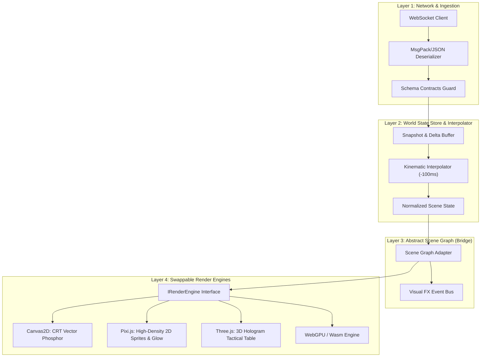

# Architecture Blueprint: Decoupled Simulation & Visual Rendering Pipeline

> **Operation Nexus / Hiveplex Visual Architecture**
> *Status: Draft Brainstorm & Technical Proposal*
> *Storage: External Brain Artifact (Decoupled from Git Repository)*

---

## 1. Executive Summary & Core Objective

The primary objective is to allow Hiveplex to **swap between completely different visual aesthetics, dimensions (2D, 2.5D, 3D), and rendering engines (HTML5 Canvas2D, Pixi.js, Three.js, Babylon.js, or Godot Web)** seamlessly, without touching a single line of the Python simulation kernel or backend wire protocol.

```
┌─────────────────────────────────────────────────────────────┐
│                   Python Sim Kernel (10 Hz)                 │
│         Authoritative, Deterministic, Headless               │
└──────────────────────────────┬──────────────────────────────┘
                               │ Binary msgpack / JSON WS
                               ▼
┌─────────────────────────────────────────────────────────────┐
│               Sim State Buffer & Interpolation               │
│         (Snapshot / Delta, Tick Sync, Dead-Reckoning)        │
└──────────────────────────────┬──────────────────────────────┘
                               │ Generic Render Model (IRenderModel)
                               ▼
┌─────────────────────────────────────────────────────────────┐
│                 Renderer Agnostic Facade                     │
│               (Viewport, Camera, SceneGraph)                │
└───────┬──────────────────────┼───────────────────────┬──────┘
        │                      │                       │
        ▼                      ▼                       ▼
┌──────────────┐       ┌──────────────┐        ┌──────────────┐
│  Renderer A  │       │  Renderer B  │        │  Renderer C  │
│ 2D Canvas /  │       │ 2.5D / 3D    │        │ High-Fi      │
│ Vector Glow  │       │ Three.js     │        │ WebGPU /     │
│ (CRT Signal) │       │ (Holo-Table) │        │ PixiJS       │
└──────────────┘       └──────────────┘        └──────────────┘
```

---

## 2. The Decoupling Strategy: "State vs. Stage"

To achieve absolute decoupling, the system separates **State** (what is happening in the world) from **Stage** (how entities and effects are materialized on screen).

### 2.1 The Four-Layer Pipeline



### 2.2 Boundary Separation Rules

1. **No Graphics Primitives in State:** State messages never specify colors, textures, pixel dimensions, or drawing commands. State only transmits positions, headings, velocities, entity kinds, faction affiliations, health percentages, and abstract semantic events (e.g., `MISSILE_INTERCEPT`, `NODE_CAPTURED`, `SUPPLY_STARVED`).
2. **Normalized Coordinates ($0.0 \dots 1.0$ or Real-World Meters):** The sim transmits positions in meters relative to theater origin `(0, 0)`. The rendering engine maps these meters to screen pixels, WebGL projection matrices, or isometric tiles based on its own camera/viewport configuration.
3. **Decoupled HUD vs. Main Stage:** HUD overlays (momentum bar, sitrep ticker, rotating stats panel) live as DOM elements above the canvas/viewports. Whether the canvas is rendered in 2D or 3D, the broadcast telemetry HUD remains uniform and crisp at native 1080p / 9:16 resolutions.

---

## 3. The `IRenderEngine` Contract

Every visual style (2D vector, 3D holo-table, thermal FLIR, retro-grid) implements a uniform lifecycle:

```typescript
export interface IRenderEngine {
  /** Initialize canvas context, shaders, buffers, and textures */
  initialize(container: HTMLElement, options: RenderConfig): Promise<void>;

  /** Handle viewport resizing and DPI scaling (1080p, 4K, 9:16 mobile) */
  resize(width: number, height: number, pixelRatio: number): void;

  /** Update terrain, static contours, bridges, and infrastructure */
  updateTheaterMap(theater: TheaterData): void;

  /** Apply interpolated dynamic entities for the current render frame */
  renderFrame(frame: RenderFrameState): void;

  /** Trigger ephemeral visual effects (missile tracers, explosion bursts, radar sweeps) */
  triggerEffect(effect: VisualEffectEvent): void;

  /** Set camera focus for PiP (Picture-in-Picture) or tactical zoom */
  setCameraTarget(target: CameraTarget): void;

  /** Clean up resources when switching themes or engines */
  dispose(): void;
}
```

### 3.1 `RenderFrameState` (Engine-Agnostic Input)

```typescript
export interface RenderFrameState {
  renderTick: number;
  serverTimeMs: number;
  interpolationAlpha: number; // 0.0 to 1.0 between snapshot A and B
  
  // Entities ready for drawing
  units: Map<number, VisualUnit>;
  facilities: VisualFacility[];
  supplyNodes: VisualNode[];
  supplyRoutes: VisualEdge[];
  contestedZones: VisualContestedZone[];
  fogOfWar: FogMaskData;
  annotations: VisualAnnotation[];
}

export interface VisualUnit {
  id: number;
  callsign: string;
  side: 'COALITION' | 'ENEMY';
  kind: 'STRIKE_FIGHTER' | 'RECON_UAV' | 'LOGI_TRUCK' | 'ENEMY_ARMOR' | etc;
  x: number; // meters from theater origin
  y: number; // meters from theater origin
  headingDeg: number;
  damageState: 'HEALTHY' | 'DAMAGED' | 'DISABLED';
  isSelected: boolean;
  isAiControlled: boolean;
  trailHistory: Array<{ x: number; y: number; alpha: number }>;
}

export interface VisualEdge {
  id: string;
  sourceNodeId: string;
  targetNodeId: string;
  layer: 'ROAD' | 'SEA_LANE';
  roadClass: 'MSR_PRIMARY' | 'CONNECTOR_SPUR' | 'BRIDGE_CAUSEWAY';
  speedMult: number;
  bridgeId?: string;
  bridgeIntegrityPct?: number; // 0 to 100
  activeConvoyCount: number;
  isContested: boolean;
  waypointsMeters: Array<[number, number]>;
}
```

---

## 4. Visual Styles & Paradigm Exploration

| Visual Paradigm | Dimension | Technology Stack | Visual Inspiration | Strengths | Trade-offs |
|---|---|---|---|---|---|
| **A. "Signal" Phosphor CRT** | 2D Vector | Canvas2D or Pixi.js | *DEFCON*, *HighFleet*, NORAD radar consoles, 80s tactical scopes | Instant readability, extremely lightweight (<5ms frame time), low GPU footprint in OBS | Limited sense of verticality/altitude |
| **B. Holographic War Table** | 2.5D / Isometric | Three.js or Babylon.js | *Ender's Game*, *Star Wars* briefing room, *Total Annihilation* radar | High production value, visually striking devlog showcase, excellent depth for air vs ground | Slightly higher GPU memory usage; camera angles must preserve grid readability |
| **C. Modern C2 Glass Cockpit** | 2D High-Tech | Pixi.js + SVG Layering | Boeing Link-16, modern F-35 tactical glass, *Command: Modern Operations* | Ultra-sharp typography, mil-spec data density, realistic flight symbology | Can feel intimidating if visual hierarchy is not carefully tuned |
| **D. FLIR Thermal / Recon Drone** | 2D/3D Hybrid | Custom GLSL Shaders | AC-130 gunship camera, thermal predator vision (White-Hot / Black-Hot) | Perfect for the PiP Intercept Scope; instant combat drama and twitch clip appeal | Not suitable for the entire full theater map (eye strain over 24/7 hours) |
| **E. Stylized Vector Voxels / Micro-Machines** | 3D Low-Poly | Three.js + Flat Shading | *Advance Wars 3D*, *Mini Motorways*, *Bad North* | Friendly, playful tone (aligns with "fun, non-grim co-op"), high streamer appeal | Deviates from the raw "NORAD military war-room" aesthetic |

---

## 5. Architectural Recommendations for Seamless Swapping

### 5.1 Hot-Swappable Renderer Registry
Create a singleton `RenderManager` in the overlay frontend that registers available render engines:

```typescript
class RenderManager {
  private activeEngine: IRenderEngine;
  private engines = new Map<string, () => IRenderEngine>();

  register(themeId: string, factory: () => IRenderEngine) {
    this.engines.set(themeId, factory);
  }

  async switchTheme(themeId: string) {
    if (this.activeEngine) {
      this.activeEngine.dispose();
    }
    const factory = this.engines.get(themeId);
    if (!factory) throw new Error(`Unknown theme: ${themeId}`);
    
    this.activeEngine = factory();
    await this.activeEngine.initialize(this.container, this.config);
    this.activeEngine.updateTheaterMap(this.currentTheater);
  }
}
```

### 5.2 Decoupled Audio & Visual Events
Sound cues (tactical chimes, radio squelch, mastermind glitch static) and visual HUD toasts are triggered by standard sim events (`UnitSpawned`, `NodeCaptured`, `SupplyStarved`, `MastermindTaunt`) via an in-memory event bus. Swapping the 3D table for a 2D radar has zero effect on the audio or broadcast HUD layers.

### 5.3 Live-Stream Streamer Controls
In the admin Command Center (or via secret query params like `?theme=crt` or `?theme=holo3d`), the broadcaster or devlog creator can switch visual renderers on the fly without refreshing OBS or disconnecting viewers.
