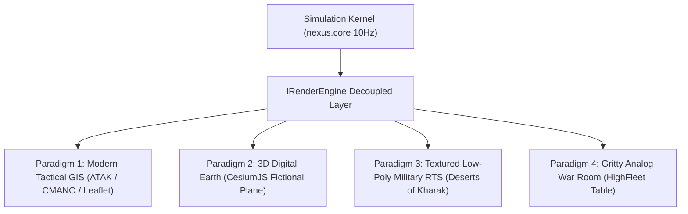

# Fictional Terrain Generation & Non-Wireframe Visual Paradigms

## 1. Executive Summary & Fictional Lore Mandate

### 1.1 The Fictional Neutrality Principle
**Operation Nexus / Hiveplex takes place in a strictly fictional setting.** The operational theaters (*Theater 1: Strait One — Contested Lifeline*, $400\text{ km} \times 240\text{ km}$) and factions (**The Coalition / Quorum** vs. **The Static / Null**) must never reference or resemble real-world geopolitical boundaries, disputed territories, or active military conflict zones.

Commercial GIS platforms (Mapbox, Cesium ion, Google Earth, Bing Maps) carry fatal risks:
1. **Political Controversy**: Accidental depiction of contested sovereign borders or sensitive real-world installations.
2. **Platform TOS Restrictions**: Twitch and YouTube policies against depicting real-world active warfare.
3. **API Licensing & Costs**: Strict rate limits and per-tile pricing incompatible with continuous 24/7 broadcasting.

### 1.2 The Solution: 100% Synthetic Geospatial Data
We generate our own **DTED (Digital Terrain Elevation Data)**, bake our own **synthetic satellite orthomosaics**, and slice them into **custom local tilesets** using open-source algorithms.

---

## 2. Four Non-Wireframe Paradigms

Beyond holographic wireframes, four distinct visual paradigms serve different operational and broadcast needs:

### Paradigm 1: Modern Tactical GIS / C2 Map (The "ATAK / CMANO" Look)
- **Aesthetic**: Authentic Pentagon/NATO joint operations center display.
- **Visual Features**: Multi-directional shaded relief hillshades, elevation contour lines, MGRS coordinate grid ticks, NATO MIL-STD-2525D symbology (blue friendly rectangles, red hostile diamonds), kinematic velocity leader lines, and dynamic radar/SAM threat domes.
- **Tech Stack**: **Leaflet** with `L.CRS.Simple` (pure flat Euclidean meters $[x, y]$) or **MapLibre GL JS** consuming vector tiles. Zero spherical projection needed.

### Paradigm 2: Digital Earth / Geospatial 3D (The "CesiumJS / Palantir" Look)
- **Aesthetic**: Orbital satellite intelligence feed.
- **Visual Features**: Synthetic satellite imagery draped over 3D terrain elevation tiles, atmospheric scattering, and smooth zoom from orbital overview ($500\text{ km}$) down to a 3D chase camera trailing low-flying fighters.
- **Tech Stack**: **CesiumJS** in planar mode (`Cesium.FlatProjection`) or anchored to an isolated fictional "Null Island" coordinate box in the open ocean with custom Quantized-Mesh `.terrain` tiles.

### Paradigm 3: Textured Low-Poly / Stylized Military 3D (The "Deserts of Kharak / Carrier Command 2" Look)
- **Aesthetic**: Modern tactical RTS with physical weight and cinematic flair.
- **Visual Features**:
  - **Textured Terrain**: Solid multi-texture splatting (arid sandy soil, rocky scree slopes, dark asphalt roads with painted white dashed lines, concrete airbase aprons).
  - **Textured 3D Unit Models**: Low-poly strike jets with matte naval camouflage and afterburner glows; 8-wheel military transport trucks with cargo tarps and rolling tires; concrete hangars, rotating radar dishes, and truss bridges.
  - **Water with Depth**: Coastal shallows fade into deep navy channel trenches.
- **Tech Stack**: **Three.js** with PBR standard materials, custom vertex displacement shaders, and optimized glTF/GLB models.

### Paradigm 4: Gritty Analog War Room (The "HighFleet" Look)
- **Aesthetic**: Diegetic physical command bunker.
- **Visual Features**: Physical wooden/metal plotting table with overhead brass lamps, folded paper map textures, grease-pencil tactical arrows, slide-rule calipers, and oscilloscope monitors showing real-time radar squelch waveforms.

---

## 3. Potential Repeatable Skills & Workflows

To ensure future agents and developers build on this work without restarting from scratch:

| Repeatable Skill / Workflow | Target Directory | Primary Purpose |
| :--- | :--- | :--- |
| **`synthetic-terrain-baking`** | `tools/terrain/` & `.agents/skills/` | Generates 16-bit synthetic DTED elevation rasters, computes Sobel analytical hillshades, and slices them into local XYZ tiles (`/z/x/y.png`). |
| **`tactical-gis-rendering`** | `apps/overlay/src/gis/` | Renders flat Euclidean 2D tactical maps using Leaflet `L.CRS.Simple` or MapLibre, plotting MIL-STD-2525D symbology and kinematic vectors from `RenderFrameState`. |
| **`lowpoly-pbr-pipeline`** | `tools/assets/` & `apps/overlay/src/3d/` | Ingests, optimizes, and textures low-poly military glTF assets (strikers, haulers, radar spires) with faction camouflage and PBR materials. |
| **`headless-visual-review`** | `.agents/skills/hiveplex-visualization/` | Automated verification script (`capture_review_screenshot.sh`) using headless Chrome to inspect WebGL and 2D canvas renders across 16:9 and 9:16 vertical. |

---

## 4. The Three-Pillar Visual Strategy & Technical Roadmap

Hiveplex formally establishes three core visual styles:
1. **Pillar 1: Modern Tactical GIS / C2 Operations Map (ATAK / CMANO)**
   - Used for: Strategic campaign monitoring, web replay, and **MGRS grid-based unit command tasking** (`!strike <grid>`, `!patrol <route>`).
2. **Pillar 2: Textured Low-Poly Military RTS (Deserts of Kharak / Carrier Command 2)**
   - Used for: Primary 24/7 live stream viewing, dynamic combat dogfights, convoy logistics, and short-form video releases (Shorts/TikTok).
3. **Pillar 3: Holographic Tactical Wireframe (Tabletop / DEFCON)**
   - Used for: Abstract strategic overview, sensor manager mode, and low-bandwidth/low-noise stream segments.

### 4.1 Future Engineering Focus Areas
- **Road Elevation Snapping & Spline Draping**: Conforming road ribbons to rolling DEM heights ($y = \text{SampleDEM}(x, z) + 0.22\text{m}$) without Z-fighting or clipping.
- **PBR Texture Splatting & Biome Blending**: Multi-texture shader blending coastal sand, arid steppe, craggy granite (triplanar mapped), and asphalt.
- **MGRS Tactical Coordinate Grid**: Bidirectional mapping between simulation coordinates and military grid callouts for chat/web command interaction.
- **Faction Harmonization**: Consistent visual identification for Coalition (Quorum cyan/navy) and Static (Null scarlet/carbon black).
