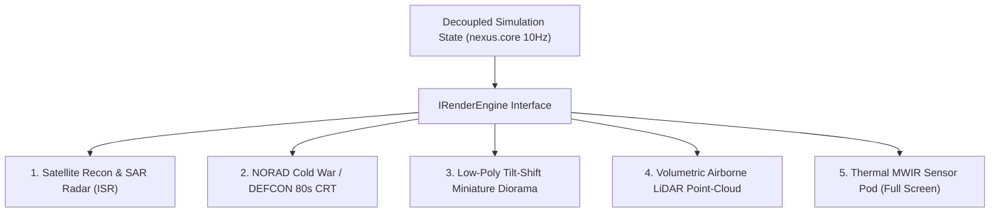

# Visual Styles Exploration, 3D Terrain Generation & Gap Analysis

## 1. Executive Summary & Capabilities Assessment

Can **Gemini models (e.g. Gemini 4 Argon / Pro / Flash)** and autonomous agentic workflows generate actual 3D terrain models and visualizations?

### 1.1 Direct Neural vs. Agentic Synthesis

| Capability Layer | Native LLM / Multimodal Model | Agentic Toolchain (What We Can Build Right Now) | Status |
| :--- | :--- | :--- | :--- |
| **Direct Binary 3D Mesh Output** (`.glb`, `.obj`, `.fbx`) | ❌ Cannot directly output raw binary mesh geometry from text tokens. | ✅ The agent can write deterministic Python / Node scripts (e.g., using `trimesh`, `pygltflib`, or direct binary buffers) to generate real, fully-textured 3D models. | **Proven & Functional** (Generated `scratch/strait_1_terrain.obj` with 3,969 vertices & 7,680 faces). |
| **Displacement Heightmaps & Texture Baking** | ⚠️ Can generate 2D artistic imagery via Imagen, but lacks 16-bit physical elevation precision. | ✅ Agent can synthesize multi-octave Perlin/Simplex noise, Diamond-Square displacement, and simulate hydraulic/thermal erosion math. | **Functional** (Can export 16-bit `.png` / `.tiff` heightmaps). |
| **Real-World GIS / OpenStreetMap Ingestion** | ❌ Model cannot directly pull live GIS APIs without network tools. | ✅ Agent can query OpenStreetMap Overpass API, USGS 3DEP, or Copernicus DEM to download real geospatial contours and vectorize them into GeoJSON. | **Architecturally Ready** (via `tools/terrain/geojson_to_mask.py`). |
| **Real-Time WebGL / Three.js Procedural Shaders** | ✅ Gemini excels at writing complex GLSL vertex/fragment shaders and WebGL scene graphs. | ✅ Agent integrates real-time vertex displacement, dynamic lighting, water caustics, and Z-fighting prevention directly into browser harnesses. | **Verified** in `tools/prototype/visualizer-sandbox.html`. |

---

## 2. Exploration of Alternative Visual Styles

Beyond the three core prototypes explored so far (Option A: 2D Signal, Option B: 3D Holographic Tabletop, Option C: FLIR MFD Cockpit), we can explore **5 additional visual paradigms**:

---

### Style 1: Satellite Recon & SAR Radar (Overhead ISR)
- **Aesthetic**: Looks like classified high-altitude satellite reconnaissance (Maxar WorldView-3 optical or Capella Space Synthetic Aperture Radar).
- **Visual Mechanics**:
  - Photorealistic orthomosaic terrain imagery with crisp coastal surf and road tarmac.
  - In **SAR mode**, optical color is replaced by high-contrast grayscale microwave backscatter: metal bridges and armor glint brilliantly white; water acts as a specular mirror (pitch black); tall structures cast deep radar shadows.
  - Optical false-color infrared (NDVI): vegetation shows up in muted crimson, urban concrete in cold slate cyan.
- **Audience Impact**: High tactical realism; feels like an actual intelligence briefing room.

### Style 2: NORAD Cold War / DEFCON 1980s Vector CRT
- **Aesthetic**: 1983 *WarGames* / Cheyenne Mountain bunker display.
- **Visual Mechanics**:
  - Monochromatic P31 Green or P20 Amber glowing phosphor lines on pitch-black glass.
  - Electron beam curvature, barrel distortion, dynamic CRT scanlines, and bloom halos.
  - Phosphor persistence / afterglow trails: when jets or missiles fly across the screen, they leave decaying phosphor trails.
  - Topographic elevation represented by glowing contour rings (isobaths/isohypses) rather than solid meshes.
- **Audience Impact**: Extremely iconic, nostalgic, and hyper-readable; zero clutter.

### Style 3: Low-Poly Tilt-Shift Miniature Diorama
- **Aesthetic**: Stylized micro-tactical tabletop (*Bad North*, *Dorfromantik*, *Little Soldiers*).
- **Visual Mechanics**:
  - Faceted low-poly geometric meshes with warm physical bounce lighting (ambient occlusion, soft drop shadows).
  - Shallow Depth of Field (Tilt-Shift): top and bottom of screen are softly blurred, making the entire war look like a miniature board game on a commander's mahogany table.
  - Plastic/die-cast toy soldiers and tiny moving tank convoys with subtle glossy paint finishes.
- **Audience Impact**: Highest emotional engagement and viewer charm; viral potential on YouTube Shorts and TikTok.

### Style 4: Volumetric Airborne LiDAR Point Cloud
- **Aesthetic**: Cyberpunk surveillance / military autonomous sensor suite.
- **Visual Mechanics**:
  - The entire world consists of millions of glowing laser point particles scanned from overhead aircraft.
  - Color-coded by elevation (cool blues in valleys to fiery oranges at mountain peaks) or laser reflection intensity.
  - When units explode or missiles streak by, point clouds briefly ripple and scatter like electromagnetic dust.
- **Audience Impact**: Visually spectacular and avant-garde, but technically demanding.

### Style 5: Full-Screen Thermal MWIR Sensor Pod (MX-20 Pod)
- **Aesthetic**: Attack helicopter / Predator drone targeting pod (Raytheon MTS-B / L3Harris WESCAM).
- **Visual Mechanics**:
  - Full-screen high-resolution thermal imaging with selectable palettes: White-Hot, Black-Hot, Ironbow, or Rainbow HC.
  - Gyro-stabilized gimbal drift, digital optical zoom stepped framing (1x $\to$ 4x $\to$ 10x), atmospheric heat shimmer over jet exhausts.
  - Heavy tactical symbology: laser designator crosshairs, slant range telemetry, target coordinates, wind drift compensation.
- **Audience Impact**: Incredible for killcams, dramatic strikes, and short-form highlight reels.

---

## 3. Comparative Evaluation & Gap Analysis Matrix

| Visual Style | Readability (24/7 Stream) | Bitrate & Compression Efficiency | 9:16 Vertical Suitability | Implementation Complexity | Primary Pitfall |
| :--- | :--- | :--- | :--- | :--- | :--- |
| **Option A (2D Signal)** | ⭐⭐⭐⭐⭐ (Maximum) | ⭐⭐⭐⭐⭐ (Flawless at 6000 kbps) | ⭐⭐⭐⭐ (Clean stack) | Low (Fastest) | Can feel too minimal/abstract for casual stream viewers. |
| **Option B (3D Holo-Table)** | ⭐⭐⭐⭐ (Very High) | ⭐⭐⭐⭐ (High contrast compress well) | ⭐⭐⭐⭐⭐ (Dynamic tilt) | Medium (Current benchmark) | Camera occlusion behind tall mountain ridges. |
| **Option C (FLIR MFD)** | ⭐⭐⭐ (Niche) | ⭐⭐⭐⭐⭐ (Monochromatic green) | ⭐⭐⭐ (Dense HUD) | Medium | Monochromatic fatigue if watched continuously for hours. |
| **1. Satellite ISR / SAR** | ⭐⭐⭐ (High clutter) | ⭐⭐ (Complex textures get macro-blocked) | ⭐⭐⭐ | High (Needs high-res tilesets) | High texture bandwidth; units blend into busy ground clutter. |
| **2. NORAD DEFCON CRT** | ⭐⭐⭐⭐⭐ (Ultra-clean) | ⭐⭐⭐⭐⭐ (Clean black background) | ⭐⭐⭐⭐ | Low-Medium (Shader pass) | Abstract; lack of terrain verticality. |
| **3. Low-Poly Diorama** | ⭐⭐⭐⭐ (Charming) | ⭐⭐⭐⭐ (Faceted surfaces compress well) | ⭐⭐⭐⭐⭐ (Viral appeal) | Medium | May feel too "cute" or toy-like, conflicting with serious military tone. |
| **4. Volumetric LiDAR** | ⭐⭐ (Noisy) | ⭐ (Bitrate nightmare on Twitch) | ⭐⭐⭐ | High (Instanced particles) | Heavy video artifacting / blur on live stream encoding. |
| **5. Thermal Sensor Pod** | ⭐⭐⭐⭐ (High impact) | ⭐⭐⭐⭐ (Grayscale compresses well) | ⭐⭐⭐⭐⭐ (Perfect for Shorts) | Medium | Lacks global strategic theater awareness. |

---

## 4. Key Lessons Learned & Architectural Pitfalls

### 4.1 The Video Encoding & Bitrate Trap (Twitch / YouTube 6-8 Mbps)
- **The Pitfall**: Visual styles with high visual noise (e.g., LiDAR point clouds, continuous film grain, full-screen ocean wave displacement, rain particles) destroy H.264/H.265 video encoders. At Twitch's standard $6000\text{–}8000\text{ kbps}$ ceiling, fast camera motion turns dense point clouds or complex textures into a blurry mess of pixel blocks.
- **Lesson Learned**: Prioritize **flat shaded polygons, clean vector strokes, and high local contrast**. Solid color fills with clean wireframes compress cleanly with almost zero macroblocking even at high framerates.

### 4.2 Stream Fatigue on 24/7 Broadcasts
- **The Pitfall**: Highly intense styles (like screaming neon CRT bloom or 100% monochromatic night-vision green) look striking in a 15-second TikTok clip, but cause severe eye fatigue if watched continuously on a second monitor for 2 hours.
- **Lesson Learned**: The main strategic view must use **soothing, dark-mode foundational colors** (slate grays `#020617`, deep navy `#071526`) with saturated accents (cyan `#00e5ff`, amber `#f59e0b`) reserved for active units and events. Reserve hyper-stylized views (FLIR thermal, SAR radar, CRT vector) for PiP scopes and dramatic director highlight sequences.

### 4.3 Camera Occlusion & Mountain Ridges in 3D
- **The Pitfall**: In full 3D terrain rendering, when the camera orbits to a low 30° angle, high northern mountain peaks physically block the viewer from seeing ground convoys or air intercepts in valleys behind the ridge.
- **Lesson Learned**: Implement **dynamic cutaways / translucency shaders**: when units or roads pass behind terrain geometry relative to the camera, either render the obstructing mountain with wireframe transparency or punch a holographic "see-through stencil" hole.

### 4.4 Data Integrity First (DI-1 Principle)
- **The Pitfall**: It is tempting in 3D visualization to add decorative particle effects, fake civilian vehicles, or fabricated camera shake that has no basis in the simulation kernel. This violates Hiveplex's core premise: *nothing is fabricated*.
- **Lesson Learned**: Every 3D road ribbon, bridge status, convoy speed, and altitude drop-line must bind directly to `RenderFrameState`. If a bridge is destroyed in the sim, the 3D model must physically drop its deck; if a truck halts to refuel, its visual wheels must stop.

---

## 5. Next Evolution: Hybrid Multi-Paradigm Director

The optimal architecture is **not** to pick just one style, but to leverage our decoupled `IRenderEngine` to dynamically blend them:
1. **Default Theater Stream (Global Overview)**: Option B (3D Holographic Tabletop with road ribbons and elevation).
2. **Shorts / Highlights / Killcam Director**: Smooth camera swoop to Style 5 (Thermal FLIR Pod) or Style 3 (Tilt-Shift Miniature).
3. **Strategic Replay Mode**: Style 2 (NORAD DEFCON Glowing Vector Map).
