# SPEC: State Machines & End-to-End Flows

Status: Draft · Owner: — · Tracker: NX-101…NX-126, NX-150…NX-157, NX-170…NX-179, NX-190…NX-204, NX-250…NX-256 · Related ADRs: 0001, 0002, 0003, 0007, 0009

> Event, command and reject-reason names come from [CONTRACTS](CONTRACTS.md); balance key names come from [CONFIG-AND-CONTENT §6](CONFIG-AND-CONTENT.md). This spec uses those names exactly.

> This spec collects the lifecycle of every stateful thing in the system, so that agents implement **one** agreed set of transitions instead of inventing their own. Numbers come from other specs and are **PROPOSED** there (DATA-INTEGRITY DI-7). This spec doesn't introduce new numbers. Transitions that depend on an open owner decision are tagged with that decision's question ID.

## 1. Purpose
- Define states, events, guards, actions and invariants for each lifecycle.
- Define the end-to-end sequences across modules, so the interfaces between modules are explicit.

## 2. Goals / Non-goals
- **Goals:**
  - Unambiguous transitions.
  - Every transition is triggered by a logged command or by a tick-driven rule, so replays stay deterministic (ADR-0002).
  - Every invariant is testable.
- **Non-goals:**
  - Balance values (GAMEPLAY / `balance/*.yaml`).
  - Wire field layouts (WIRE-PROTOCOL / `contracts/`).

## 3. Conventions
- **Sim-side machines** (unit, node, bridge, campaign, objective, director) change state only inside `core.step`. Transitions are driven by commands at a tick, or by rules evaluated on that tick, and every transition emits an event.
- **Runtime-side machines** (commander, adapter, overlay client, ops) live outside the kernel. Any transition that affects the sim does so by emitting a `Command` stamped for a future tick.
- **Table format:** `State | Event / guard | Action | Next`. "—" means no action.
- **Tags:**
  - `[Q-…]` marks a transition that depends on an open question.
  - `[FB-n]` marks a registered fallback (DATA-INTEGRITY §4).

---

## 4. Sim-side state machines

### 4.1 Unit lifecycle (viewer-owned and AI-owned)

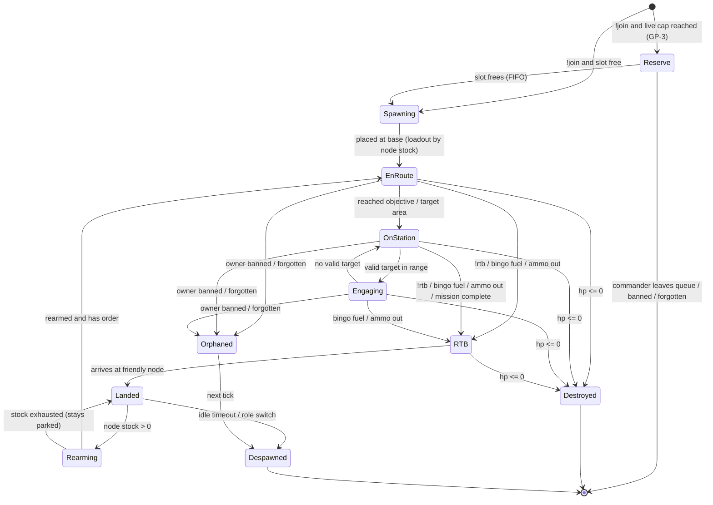

| State | Event / guard | Action | Next |
|---|---|---|---|
| — | `JOIN{role}` and live viewer units < `slots.max_viewer_units` and commander has no live unit and `slots.respawn_delay_s` has elapsed | Allocate the next sequential entity id. Map the role to its `UnitKind` (`content/units.yaml` `roles`). Choose the spawn node (closest owned base valid for the domain). Pick the loadout from node stock; below `logistics.starve_threshold`, use the reduced loadout. Debit stock. Emit `UnitSpawned`. | Spawning |
| — | `JOIN` and the cap is reached | Append to the reserve queue (FIFO by `(target_tick, arrival_seq)`). Emit `ReserveQueueJoined{commander_id, position}`. | Reserve |
| — | `JOIN` while `slots.respawn_delay_s` hasn't elapsed | Emit `CommandRejected{reason: RESPAWN_COOLDOWN}` | (no unit) |
| Reserve | Slot frees | Pop the head of the FIFO and spawn as above | Spawning |
| Spawning | Same tick, after placement | Path to the order target (theater objective by default) | EnRoute |
| EnRoute | Inside the objective radius | — | OnStation |
| OnStation | Valid target in range (GAMEPLAY §6 priority) | Assign target | Engaging |
| Engaging | Target dead, out of range, or not valid | Clear target | OnStation |
| any airborne/moving | `!rtb`, fuel ≤ bingo, ammo empty, or mission complete | Path to the nearest friendly node valid for the domain | RTB |
| RTB | Arrives at a friendly node | — | Landed |
| Landed | Node stock > 0 | Spend stock over time and restore fuel, ammo and hp (GAMEPLAY §5). Units never heal anywhere else. | Rearming |
| Rearming | Full, and there is an order | Path to the order | EnRoute |
| Rearming | Node stock hits 0 | Stop. Emit `RearmStalled{node}`. | Landed |
| Landed | Idle for `slots.idle_despawn_s` (Q-SM-2), or `JOIN` with a different role while at base | Emit `UnitDespawned{reason: IDLE \| ROLE_SWITCH}` | Despawned |
| any alive | hp ≤ 0 (combat resolution this tick) | Emit `UnitDestroyed{killer?, assists[]}`. Start the respawn delay for the owner. | Destroyed |
| any alive | Owner banned (`OP_BAN` applied → `CommanderBanned`) or forgotten (`FORGET` applied → `CommanderForgotten`) | Emit `UnitOrphaned{cause: BANNED \| FORGOTTEN}` | Orphaned → Despawned next tick with `UnitDespawned{reason: OWNER_BANNED \| OWNER_FORGOTTEN}` |

Notes:
- A unit owned by `AI_GARRISON`, `ENEMY_DIRECTOR` or an NPC wingman carries an AI owner reference and must render with the AI marker (DATA-INTEGRITY DI-5).
- Sea-domain units follow the same machine on the naval graph (P4, Q-GD-8).

**Invariants**
- U-1: a commander has at most one unit in {Spawning, EnRoute, OnStation, Engaging, RTB, Landed, Rearming} (GP-1).
- U-2: a unit's hp > 0 in every non-terminal state, and a terminal unit appears in no live index.
- U-3: hp, fuel and ammo only increase in Rearming.
- U-4: reserve queue order is strict FIFO, and a commander appears in it at most once.
- U-5: an orphaned unit is despawned within 1 tick and earns no XP after orphaning.

### 4.2 Node capture

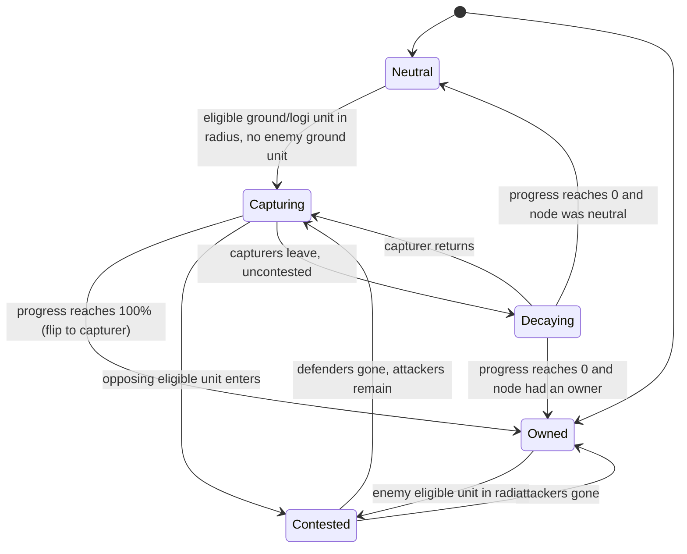

| State | Event / guard | Action | Next |
|---|---|---|---|
| Neutral / Owned | An eligible ground or logistics unit of a non-owner side enters `capture.radius_m`, with no opposing eligible unit present | Emit `CaptureStarted{node_id, side}` | Capturing / Contested |
| Capturing | Tick, still uncontested | Progress += rate × diminishing f(unit count) × `TICK_DT` | Capturing |
| Capturing | Progress ≥ 100% | Set owner = capturer. Reset progress. Emit `NodeCaptured{node_id, from, to, participant_commander_ids[]}`. | Owned |
| Capturing | Opposing eligible unit enters | Freeze progress | Contested |
| Contested | One side's eligible units are all gone | — | Capturing (attacker remains) / Owned (defender remains) |
| Capturing | No capturers, no opponents | — | Decaying |
| Decaying | Tick | Progress −= decay rate × `TICK_DT` | Decaying, then Owned/Neutral at 0 |

**Invariants**
- N-1: at most one ownership flip per node per tick.
- N-2: progress stays in [0, 100] and is monotonic while uncontested capture continues.
- N-3: air units never change capture state (GAMEPLAY §8).
- N-4: the SANCTUARY node never leaves Owned (Q-GD-7).

### 4.3 Bridge

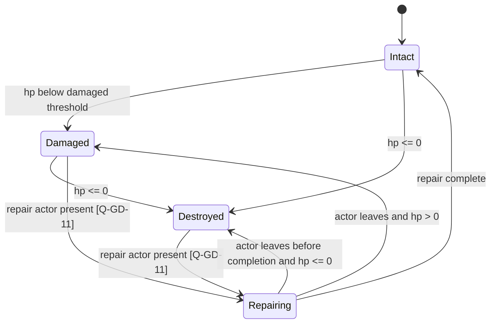

| State | Event / guard | Action | Next |
|---|---|---|---|
| Intact / Damaged | hp ≤ 0 | Remove the ROAD edge from the graph. Reroute affected convoys. Emit `BridgeDestroyed`. | Destroyed |
| Destroyed / Damaged | Repair actor in radius (**who is allowed is open: Q-GD-11**) | Restore hp at the actor's repair rate | Repairing |
| Repairing | hp = max | Restore the edge. Emit `BridgeRepaired{by}`. | Intact |

**Invariants**
- B-1: a Destroyed bridge's edge is absent from every path computed after that tick.
- B-2: a repair never exceeds max hp.

### 4.4 Campaign lifecycle

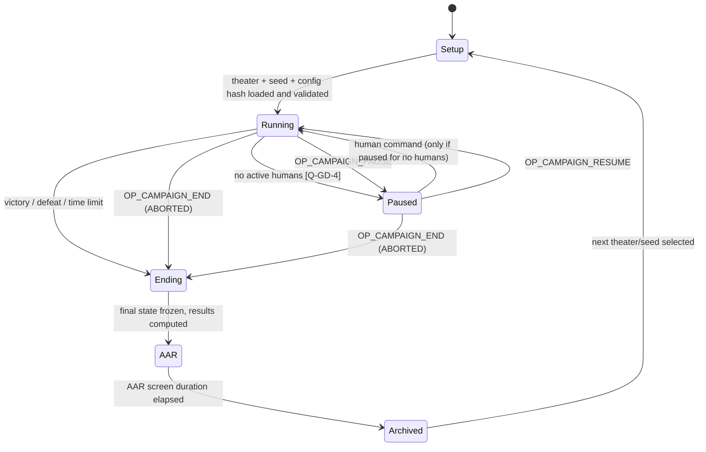

| State | Event / guard | Action | Next |
|---|---|---|---|
| Setup | Theater, seed and balance config pass schema validation | Record `campaign_id`, seed and config hash. Emit `CampaignStarted`. | Running |
| Setup | Validation fails | Refuse to start. Overlay shows "CAMPAIGN SETUP FAILED" (no fallback theater). Alert. | Setup |
| Running | `PresenceSnapshot.active_humans` < `campaign.clock_pause_below_humans` continuously for `campaign.pause_after_no_humans_s` (**Q-GD-4**, Q-SM-5) | Pause the campaign clock. AI garrison holds. Director stays in "slow war" mode. Emit `CampaignClockPaused{reason: NO_HUMANS}`. | Paused (no humans) |
| Running | `OP_CAMPAIGN_PAUSE` | Pause the clock. Emit `CampaignClockPaused{reason: OPERATOR}`. | Paused (operator) |
| Paused (no humans) | A valid human command is applied | Resume the clock. Emit `CampaignClockResumed`. | Running |
| Paused (operator) | A human command | Command is processed normally, but the clock stays paused until the operator resumes | Paused (operator) |
| Paused (either) | `OP_CAMPAIGN_RESUME` | Resume the clock. Emit `CampaignClockResumed`. | Running |
| Running | Victory condition held (GAMEPLAY §9), defeat (**Q-GD-7**), or time limit reached (decided by score) | Freeze inputs. Emit `CampaignEnded{result}`. | Ending |
| Running / Paused | `OP_CAMPAIGN_END{reason}` | Freeze inputs. Emit `CampaignEnded{result: ABORTED}`. | Ending |
| Ending | Results computed (top contributors per role, stats) | Write results to persistence. Emit `AARStarted{result, top_by_role}`. | AAR |
| AAR | `campaign.aar_duration_s` elapsed | Close the command log. Write the final snapshot. Mark archived. | Archived |
| Archived | Next theater/seed chosen (rotation rule: Q-SM-4) | — | Setup |

**Invariants**
- C-1: in Paused, the campaign clock and objective timers don't advance.
- C-2: exactly one `CampaignEnded` per campaign.
- C-3: no command is applied after Ending.
- C-4: an archived campaign's command log replays to its final state hash.

### 4.5 Theater objective

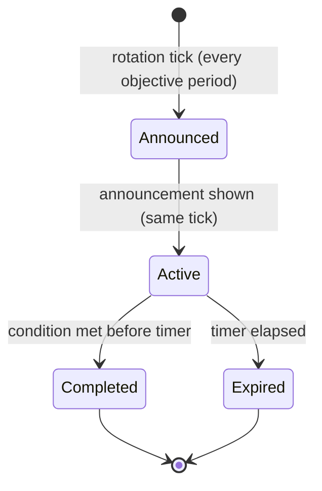

| State | Event / guard | Action | Next |
|---|---|---|---|
| — | Objective period boundary (`campaign.objective_period_min`), and campaign Running | Pick a node, weighted by frontline position. RNG stream: pending Q-SM-1 (SIM-CORE SC-5 doesn't list an objective stream yet). Emit `ObjectiveAnnounced`. | Active |
| Active | Condition met (e.g., node captured or held) | Grant merit to participants. Emit `ObjectiveResolved{outcome: COMPLETED}`. Queue a sitrep. | Completed |
| Active | Timer elapsed | Emit `ObjectiveResolved{outcome: EXPIRED}` | Expired |

**Invariants**
- O-1: exactly one Active objective while the campaign is Running.
- O-2: none while Paused. The timer is frozen (C-1).

> Open question (new, Q-SM-1): should objective selection use its own RNG sub-stream (`objective`)? SIM-CORE SC-5 currently lists only `combat`, `director`, `spawn` and `fow`.

### 4.6 Director tier

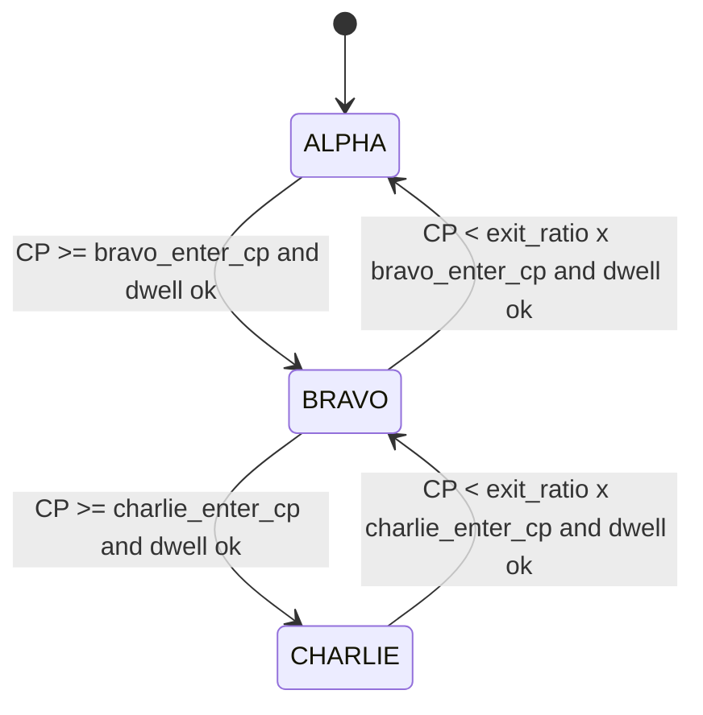

| State | Event / guard | Action | Next |
|---|---|---|---|
| any | Decision window (every `director.window_s`), with CP computed from the **enemy view only** (FOW-4) | Evaluate `director.tier.bravo_enter_cp` / `director.tier.charlie_enter_cp` with hysteresis (`director.tier.exit_ratio`) and `director.tier.min_dwell_s` | same / adjacent tier |
| any | Tier changes | Emit `ThreatTierChanged{from, to}`. Queue a sitrep. Update the HUD. | new tier |
| any | `OP_DIRECTOR_OVERRIDE{force_tier}` command (OPS-ADMIN §3) | Force the tier and record the override | forced tier |

**Invariants**
- D-1: tiers only move between adjacent levels (never ALPHA↔CHARLIE in one step).
- D-2: no transition happens before the minimum dwell has elapsed (except an operator override).
- D-3: under CP oscillating within the hysteresis band, no flapping (property test).
- D-4: spend per window ≤ the tier budget.

### 4.7 Commander lifecycle (runtime + persistence)

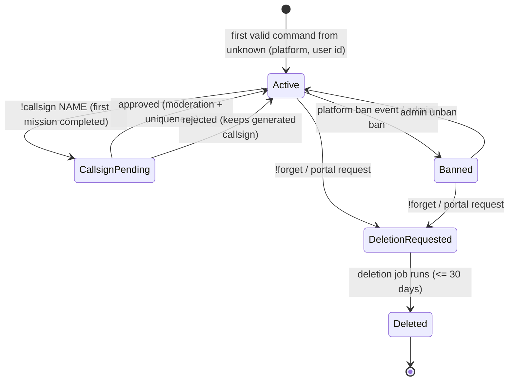

| State | Event / guard | Action | Next |
|---|---|---|---|
| — | First valid command from an unknown `(platform, platform_user_id)` | Create the commander with a generated callsign [FB-1]. Write the audit row `created`. | Active |
| Active | `!callsign NAME`, first mission completed (Q-PROG-3), and the regex passes | Normalize, moderate, check uniqueness, then queue for approval if policy requires it (Q-MOD-1/Q-MOD-2) | CallsignPending |
| CallsignPending | Approved | Set `callsign`, `callsign_kind = CUSTOM`. Audit. Issue `SYS_SET_CALLSIGN` → sim emits `CallsignChanged`. | Active |
| CallsignPending | Rejected | Keep the generated callsign. Audit with the reason. | Active |
| Active | Platform moderation ban event (e.g. Twitch `channel.ban`) or admin ban | Set `banned = true`. Issue `OP_BAN` (source SYSTEM for platform sync, OPERATOR for admin) → the sim emits `CommanderBanned`, orphans the unit and removes the commander from the reserve queue. | Banned |
| Banned | Admin unban | Set `banned = false`. Audit. | Active |
| Active / Banned | `!forget` or portal request | Set `deletion_requested_at` and create the `deletion_requests` row. Issue `FORGET` → the sim emits `CommanderForgotten` and orphans the unit. Stop accepting commands from the identity. | DeletionRequested |
| DeletionRequested | Deletion job | Delete identities. Set the callsign to the tombstone value with `callsign_kind = TOMBSTONE` and set `deleted_at` (DATA-MODEL §4.2, §6.4). Viewers see `[REDACTED]`. Shred the id→name mapping (SEC-DATA-2/3). | Deleted |

**Invariants**
- ID-1: `(platform, platform_user_id)` maps to at most one commander.
- ID-2: a Banned or DeletionRequested commander's commands are rejected before reaching the sim.
- ID-3: the raw display name is never used as a callsign.
- ID-4: a merge never sums XP (SEC-ID-6).

### 4.8 Platform adapter connection

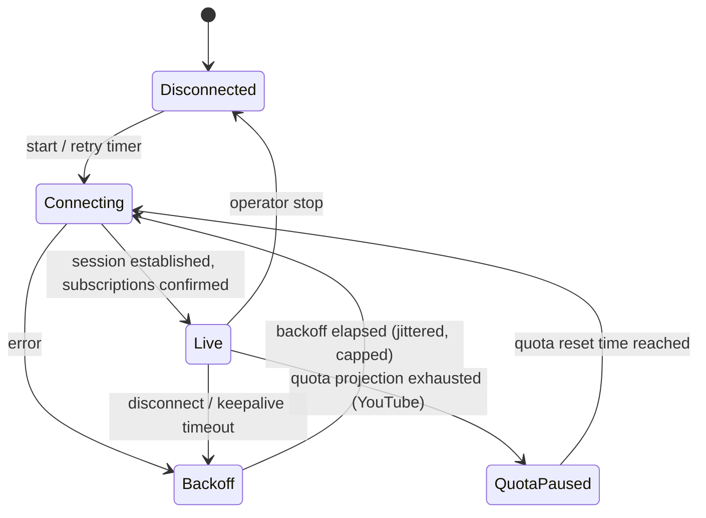

| State | Event / guard | Action | Next |
|---|---|---|---|
| Connecting | Session established (Twitch: EventSub subscription confirmed) | Set health `connected`. Clear the overlay "UPLINK LOST" chip. | Live |
| Live | Disconnect or keepalive timeout | Record the reason. Start backoff. | Backoff |
| Backoff | Down longer than the overlay threshold (CHAT-GATEWAY §7) | Overlay shows "UPLINK LOST". Alert after the alert threshold. | Backoff |
| Live | YouTube quota projection says the quota is exhausted | Stop streaming. Overlay shows "YouTube commands paused until HH:MM" (computed from the platform's reset time). Alert. | QuotaPaused |

**Invariants**
- PA-1: duplicate deliveries are deduplicated by message id in every state.
- PA-2: no command is emitted from an adapter outside Live.
- PA-3: backoff is capped and jittered (no retry storm).

### 4.9 Overlay client

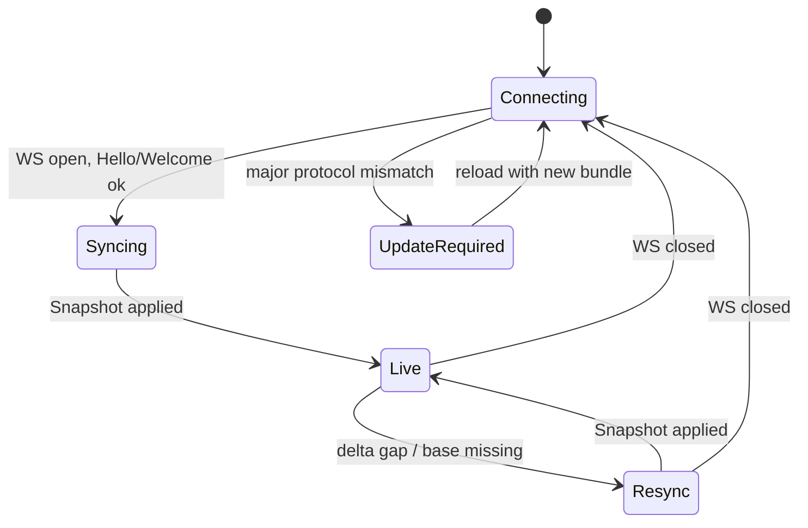

| State | Event / guard | Action | Next |
|---|---|---|---|
| Connecting | WS open, `Welcome` with a compatible major version | Send `Hello`. Request a snapshot. | Syncing |
| Connecting | Major version mismatch (WP-1) | Show "UPDATE REQUIRED". Trigger a reload. | UpdateRequired |
| Live | `Delta.base_tick` ≠ last applied tick | Request resync. Keep rendering the last good frame. | Resync |
| Live / Resync | No data for longer than the banner threshold (WP-5) | Show the "COMMS RESYNC" banner [FB-4] | (unchanged) |
| any | WS closed | Jittered exponential backoff (WP-5) | Connecting |

**Invariants**
- OC-1: the client never renders entities from a delta whose base it hasn't applied.
- OC-2: text is always rendered as text (WP-6, SEC-OV-1).

### 4.10 Ops / stream state

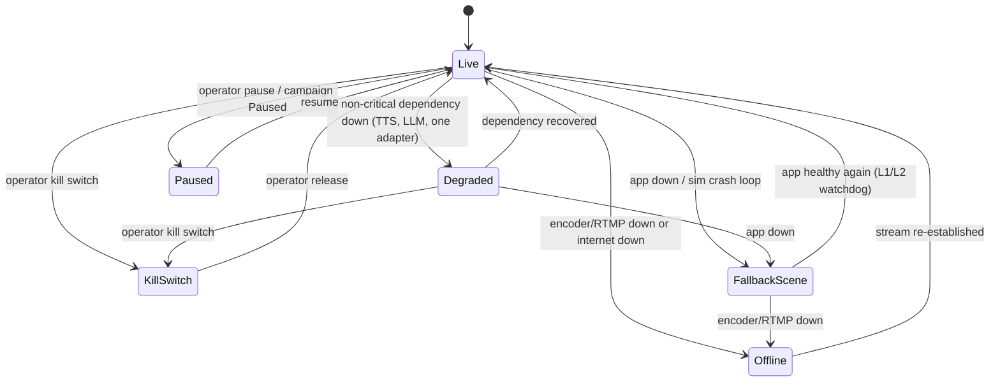

| State | Event / guard | Action | Next |
|---|---|---|---|
| Live | TTS circuit open, LLM breaker open, or one adapter out of Live | Show a degraded chip on the overlay. Text sitreps continue. | Degraded |
| Live / Degraded | Operator kill switch (SEC-MOD-3) | Blank user text, mute TTS, freeze spawns (as logged admin commands) | KillSwitch |
| any | Sim crash loop (SIM-CORE §6: repeated crashes in the window) | OBS switches to the fallback scene "TECHNICAL DIFFICULTIES – CAMPAIGN PAUSED". Alert. | FallbackScene |
| any | Stream-live probe reports offline, or L3 heartbeat missed | Alert from the layer that can reach your phone (MONITORING-WATCHDOG) | Offline |

**Invariants**
- OPS-1: in KillSwitch, no user-derived text reaches the overlay or TTS.
- OPS-2: every transition is logged with its cause, and an admin action carries an audit row.

---

## 5. End-to-end sequence flows

### 5.1 New viewer `!join strike`
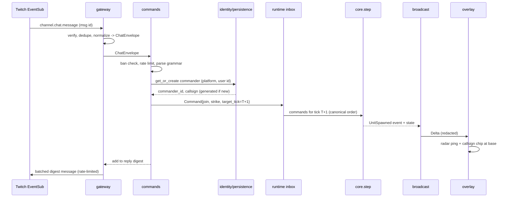
Failure branches:
- Rate-limited → dropped, and a metric is recorded.
- Cap reached → `ReserveQueueJoined`, shown in the overlay queue counter.
- Respawn delay → `CommandRejected{reason: RESPAWN_COOLDOWN}`, included in the periodic digest.

### 5.2 Kill → XP → leaderboard
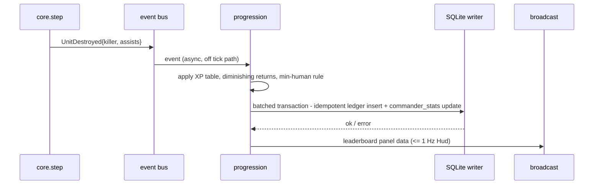
The ledger is the source of truth and `commander_stats` is derived from it in the same transaction (ADR-0003 amendment, DATA-MODEL §5). If the DB write fails, XP stays queued in a bounded buffer and the failure is alerted. The leaderboard shows only persisted values, never values that weren't saved (DI-6).

### 5.3 Capture → objective complete → sitrep
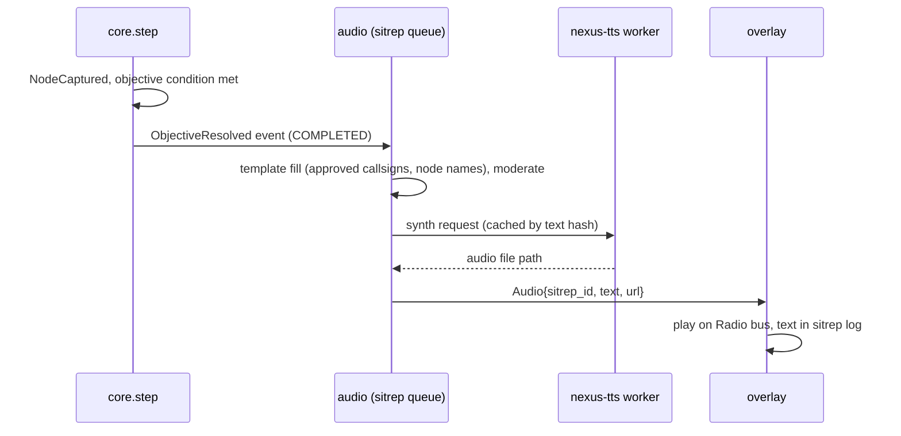
If TTS is down, the circuit breaker opens and the text sitrep still shows (Degraded, 4.10).

### 5.4 Director adaptation: convoy raids → escorts
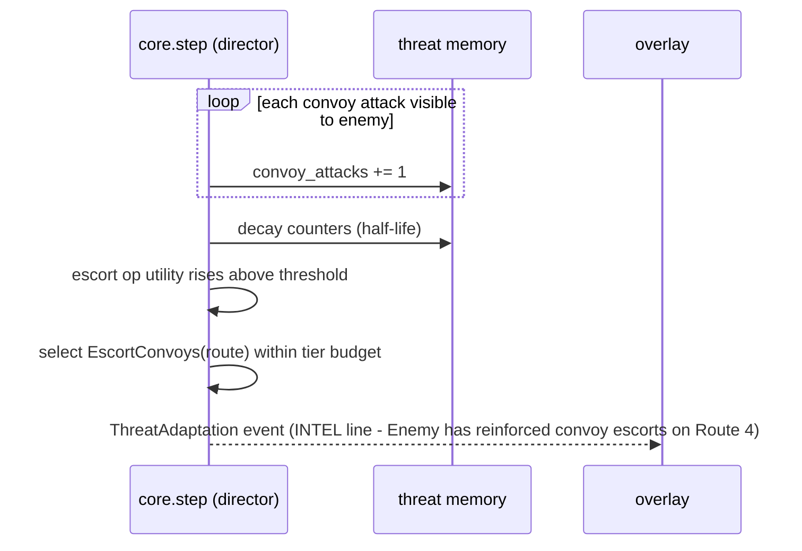
Only attacks the enemy could observe (enemy view, FOW-4) increment the counter.

### 5.5 Campaign end → AAR → next campaign
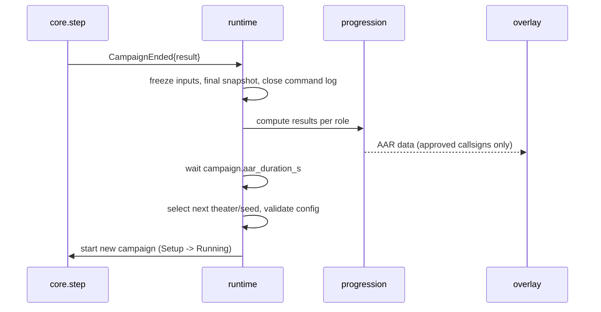

### 5.6 Crash → recovery
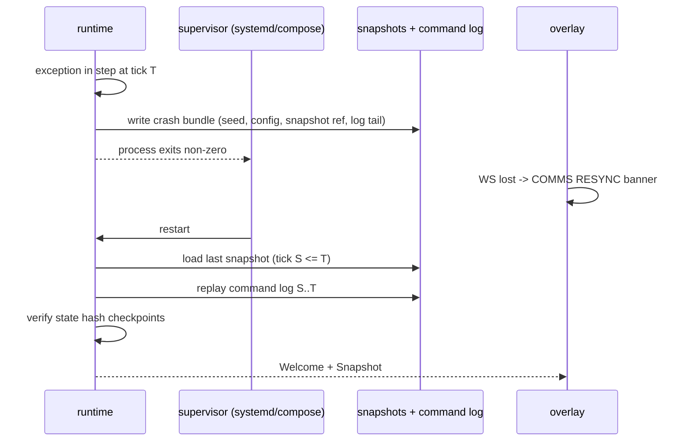
After repeated crashes inside the window (SIM-CORE §6), the runtime pauses the campaign and Ops switches to FallbackScene.

### 5.7 Deploy without dropping the stream
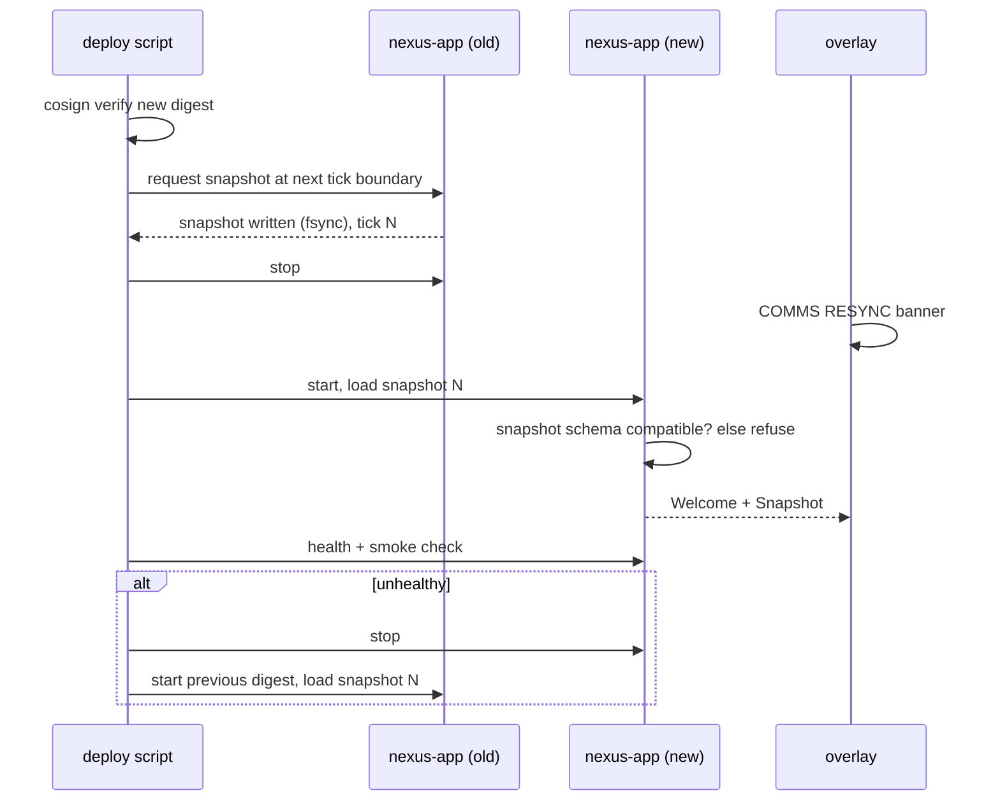

### 5.8 Moderation incident → kill switch → ban cascade
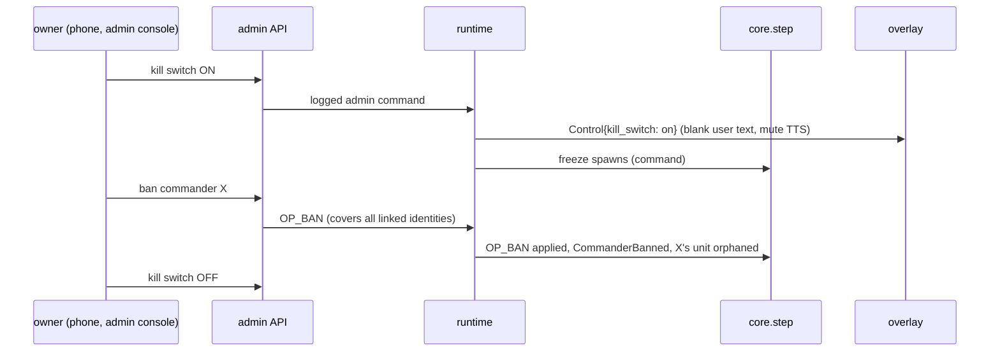
A Twitch `channel.ban` event drives the same ban path without the owner (CHAT-GATEWAY §2).

### 5.9 Internet outage (3-layer watchdog)
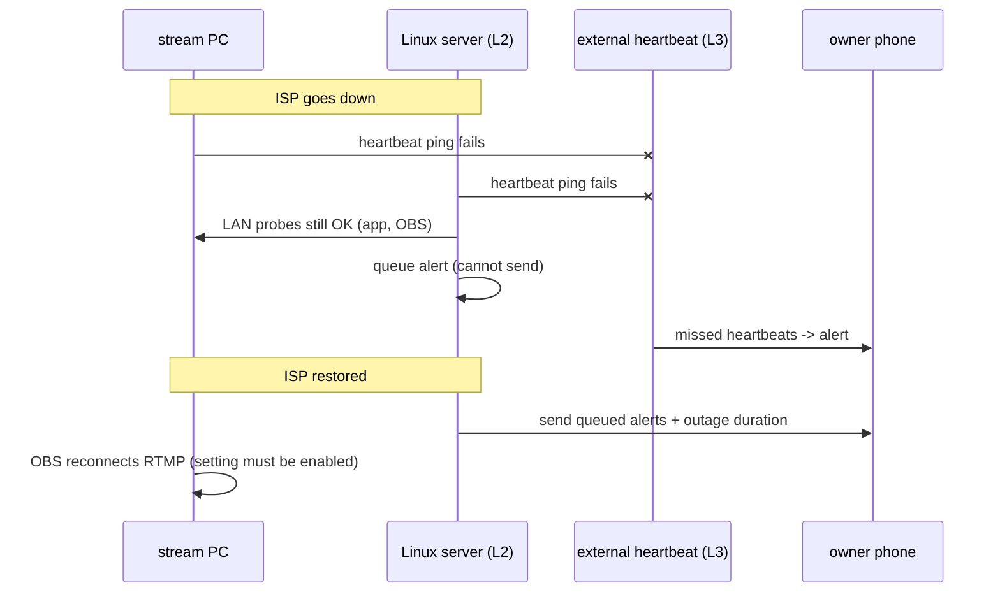

### 5.10 LLM advisor late → rule fallback [FB-2]
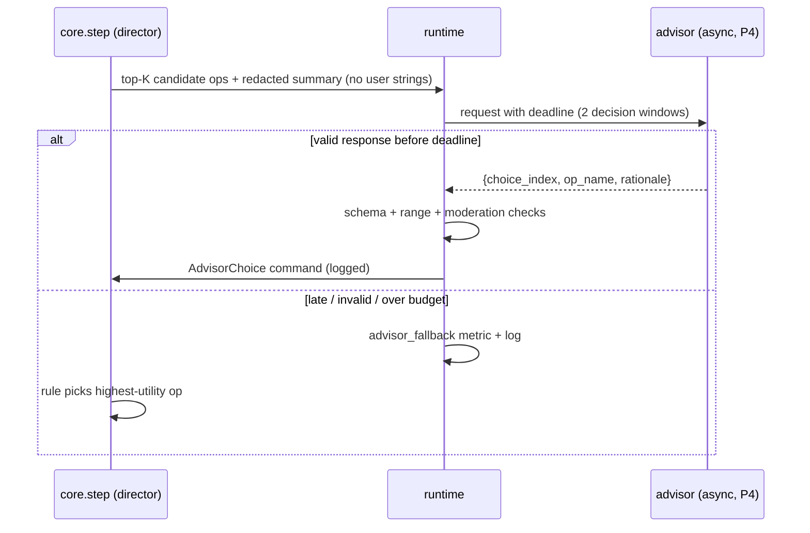

---

## 6. Failure modes (cross-cutting)
| Failure | Machine affected | Required behavior |
|---|---|---|
| Command for a terminal unit | Unit | `CommandRejected{reason: NO_ACTIVE_UNIT}`. No exception (SC-7). |
| Ban arrives mid-capture | Unit, Node | The unit is orphaned. Its capture contribution stops the same tick. |
| Theater config invalid at rotation | Campaign | Stay in Setup, alert, and don't substitute a theater (DI-2). |
| Adapter flapping | Adapter | Backoff is capped. The alert fires once per incident, not once per flap. |
| Snapshot schema change without migration | Deploy | Refuse the deploy (5.7). Never load partially. |

## 7. Test plan
| Invariant(s) | Test type | Location (planned) |
|---|---|---|
| U-1…U-5 | Property (hypothesis): random command sequences | `services/sim/tests/property/test_unit_lifecycle.py` |
| N-1…N-4 | Property + scenario | `.../test_capture.py` |
| B-1, B-2 | Property: pathfinding after destruction | `.../test_bridges.py` |
| C-1…C-4 | Scenario + golden replay | `.../test_campaign.py`, `tests/golden/` |
| O-1, O-2 | Property | `.../test_objectives.py` |
| D-1…D-4 | Property: oscillating CP | `.../test_director_tiers.py` |
| ID-1…ID-4 | Unit + integration (SQLite) | `services/sim/tests/identity/` |
| PA-1…PA-3 | Adapter fixture tests | `services/sim/tests/gateway/` |
| OC-1, OC-2 | Vitest + Playwright | `apps/overlay/tests/` |
| OPS-1, OPS-2 | Integration (kill switch) | `tests/integration/test_kill_switch.py` |
| Flows 5.6, 5.7 | Integration: kill/restore, deploy rehearsal | `tests/integration/`, staging |

Paths are planned names; they're created with their tracker items.

## 8. Open questions
Existing: Q-GD-4 (zero-human pause), Q-GD-7 (defeat), Q-GD-8 (sea domain), Q-GD-11 (bridge repair), Q-MOD-1/Q-MOD-2 (callsign approval).

Raised by this spec (tracked in [OPEN-QUESTIONS](../planning/OPEN-QUESTIONS.md)):
- **Q-SM-1:** should objective selection get its own RNG sub-stream (`objective`)? *Recommended: yes*, so that changing objective logic doesn't shift director randomness.
- **Q-SM-2:** how long does a landed, idle unit stay before it despawns? *Recommended: balance key `slots.idle_despawn_s`, tuned by the harness.*
- **Q-SM-3:** do callsign changes need manual owner approval, or does automatic moderation suffice? *Recommended: auto-moderation plus a review queue, with manual approval during alpha.*
- **Q-SM-4:** campaign rotation rule after AAR: same theater with a new seed, or rotate theaters? *Recommended: same hand-authored theater with a new seed until a second theater exists.*
- **Q-SM-5:** how long without an active human before the campaign pauses (Q-GD-4)? *Recommended: balance key `campaign.pause_after_no_humans_s`, tuned by the harness.*
