# SPEC: State Machines & End-to-End Flows

Status: §4.1–4.6 (sim side) Approved (owner, 2026-10-21, Q-SM-6); §4.7–4.10 and §5 (runtime side) Draft until P2 · Owner: — · Tracker: NX-101…NX-126, NX-150…NX-157, NX-170…NX-179, NX-190…NX-204, NX-250…NX-256 · Related ADRs: 0001, 0002, 0003, 0007, 0009

> Event, command and reject-reason names come from [CONTRACTS](CONTRACTS.md); balance key names come from [CONFIG-AND-CONTENT §6](CONFIG-AND-CONTENT.md). This spec uses those names exactly.

> This spec collects the lifecycle of every stateful thing in the system, so that agents implement **one** agreed set of transitions instead of inventing their own. Numbers come from other specs and are **PROPOSED** there (DATA-INTEGRITY DI-7). This spec doesn't introduce new numbers. Transitions that depend on an open owner decision are tagged with that decision's question ID.

## 1. Purpose
- Define states, events, guards, actions and invariants for each lifecycle.
- Define the end-to-end sequences across modules, so the interfaces between modules are explicit.

## 2. Goals / Non-goals
- **Goals:**
  - Unambiguous transitions.
  - Every transition is triggered by a logged command or by a tick-driven rule, so replays stay deterministic (ADR-0002).
  - Every invariant is testable.
- **Non-goals:**
  - Balance values (GAMEPLAY / `balance/*.yaml`).
  - Wire field layouts (WIRE-PROTOCOL / `contracts/`).

## 3. Conventions
- **Sim-side machines** (unit, node, bridge, campaign, objective, director) change state only inside `core.step`. Transitions are driven by commands at a tick, or by rules evaluated on that tick, and every transition emits an event.
- **Runtime-side machines** (commander, adapter, overlay client, ops) live outside the kernel. Any transition that affects the sim does so by emitting a `Command` stamped for a future tick.
- **Table format:** `State | Event / guard | Action | Next`. "—" means no action.
- **Tags:**
  - `[Q-…]` marks a transition that depends on an open question.
  - `[FB-n]` marks a registered fallback (DATA-INTEGRITY §4).

---

## 4. Sim-side state machines

### 4.1 Unit lifecycle (viewer-owned and AI-owned)

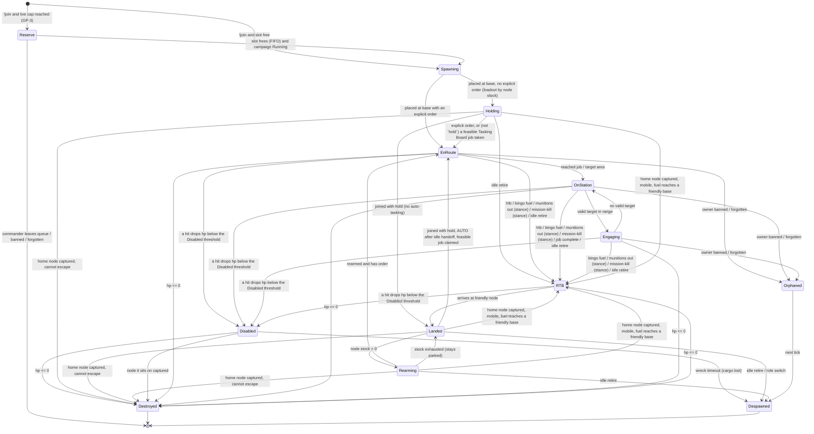

| State | Event / guard | Action | Next |
|---|---|---|---|
| — | `JOIN{role, target, hold}`, campaign Running, live viewer units < `slots.max_viewer_units` (AUTO units count, Q-ALN-9), commander has no live unit, and `slots.respawn_delay_s` (game time, Q-ALN-5) has elapsed | Allocate the next sequential entity id. Map the role to its `UnitKind` (`content/roles.yaml`). Choose the spawn node (GAMEPLAY GP-7, Q-GP-41, Q-SIM-54): a node of the theater's `spawns` list for the unit's domain, owned by the side, nearest the target (straight line for aircraft, road for ground) whose stock exceeds its starvation threshold by `logistics.forward_deploy_min_surplus`; otherwise (and for a null target or `hold`) the sanctuary. The loadout is always full. Debit it from that base's surplus (`SupplyConsumed{SPAWN}`; the sanctuary is never debited). Emit `UnitSpawned`. | Spawning |
| — | `JOIN` and the cap is reached, or `JOIN` from a commander with no live unit while the campaign is Paused, even when a slot is free (Q-ALN-2, Q-ALN-26) | Append to the reserve queue (FIFO by `(target_tick, arrival_seq)`). Emit `ReserveQueueJoined{commander_id, position}`. | Reserve |
| — | `JOIN` that would queue, from a commander not yet queued, while the queue holds `slots.reserve_queue_max` entries (GP-3; reason PROPOSED by NX-122) | Emit `CommandRejected{reason: RESERVE_QUEUE_FULL}` | (no unit) |
| — | `JOIN` while `slots.respawn_delay_s` hasn't elapsed | Emit `CommandRejected{reason: RESPAWN_COOLDOWN}` | (no unit) |
| Reserve | Slot frees and the campaign is Running (a paused campaign spawns nothing, §4.4) | Pop the head of the FIFO and spawn as above | Spawning |
| Spawning | Same tick, after placement, explicit order present (a stance alone is not an order) | Path to the order target | EnRoute |
| Spawning | Same tick, after placement | `JOIN` with a node: path to it (EnRoute). With `hold`, or with no parameters (auto-tasking runs from Holding at once, Q-GP-23): Holding | Holding or EnRoute |
| Holding | Explicit order (`TARGET`, `REBASE`; `VECTOR` and `RESCUE` come later) | Path to the order | EnRoute |
| Holding | Not `hold`, and a Tasking Board job matches the role, has a free slot and is **feasible with current fuel and munitions** | Claim the job slot, path to it. If no job is feasible, take a rearm/refuel step first (nearest base with stock). | EnRoute |
| Holding | `JOIN … hold` was used | Never auto-task; wait for an explicit order | Landed |
| EnRoute | Inside the job / target radius | — | OnStation |
| OnStation | Valid target in range (COMBAT CB-1 priority) | Assign target | Engaging |
| Engaging | Target dead, out of range, or not valid | Clear target | OnStation |
| any airborne/moving | `!rtb`, fuel ≤ bingo, or job complete | Path to the nearest friendly node valid for the domain | RTB |
| any airborne/moving | Missiles/bombs empty, stance not `press`/`guns` (Q-CBT-7) | As above | RTB |
| any airborne/moving | Damage state reaches Mission-kill and stance is `standard` (or Damaged and stance is `cautious`), still mobile (Q-CBT-6) | As above | RTB |
| any alive, moving | A hit drops hp below the Disabled threshold (can't move, not destroyed; COMBAT CB-6) | Emit `UnitDamageStateChanged{DISABLED}`. Seeded crew-survival roll; a surviving crew emits `CrewDowned` and a downed-crew marker (GAMEPLAY §6a). | Disabled |
| RTB | Arrives at a friendly node | — | Landed |
| Landed | Node stock > 0 | Spend stock over time and restore fuel, ammo and hp (GAMEPLAY §5). Units never heal anywhere else. | Rearming |
| Rearming | Full, and there is an order | Path to the order | EnRoute |
| Rearming | Node stock hits 0 | Stop. Emit `RearmStalled{entity_id, node_id}` once per stall. | Landed |
| any alive, `COMMANDER`-owned, control `OPERATOR` | **Idle handoff:** no chat command from the owner has reached the sim for `presence.idle_handoff_min` (game time, Q-GD-35, Q-ALN-1) | Set control to `AUTO`. Emit `UnitControlChanged{control: AUTO, cause: IDLE_HANDOFF}`; the overlay shows the AUTO tag. The current order is not cancelled; once it completes, the Tasking Board tasks the unit as an AI-run unit (U-6). The unit keeps its slot (Q-ALN-9). | (unchanged) |
| Holding / EnRoute / OnStation / Engaging, `COMMANDER`-owned | **Idle retire:** no chat command from the owner has reached the sim for `presence.idle_retire_min` (game time, Q-GD-35) | Release any claimed job slot. Path to the nearest friendly node valid for the domain. | RTB |
| Landed / Rearming | Idle retire elapsed (as above) | Unload carried cargo into this base's stock (Q-GD-35, Q-GP-16). Emit `UnitDespawned{reason: IDLE}`. The slot frees. | Despawned |
| Disabled, any owner, not a facility | `combat.disabled_timeout_s` (game time) has elapsed since it became Disabled. No field repair in the first build (Q-CBT-14). | Despawn in place. Carried cargo is **lost**. Emit `UnitDespawned{reason: WRECKED}`. The slot frees; the owner's respawn delay starts (GP-2). | Despawned |
| Landed, control `AUTO`, joined with `hold` | Idle handoff applies to `hold` units like any other, and the unit keeps holding (Q-ALN-25). A Tasking Board assignment pass (TB-6) finds a job that matches its role, has a free slot and is feasible (U-6) | Claim the job slot, path to it | EnRoute |
| any alive, control `AUTO` | **Reclaim:** any chat command from the owner reaches the sim (Q-ALN-9) | Set control to `OPERATOR`. Emit `UnitControlChanged{control: OPERATOR, cause: RECLAIM}`. Then evaluate the command against this unit; a `JOIN` never spawns a second unit. | (per command) |
| Landed | `JOIN` with a different role while at base | Emit `UnitDespawned{reason: ROLE_SWITCH}` | Despawned |
| Holding / Landed / Rearming at node N | N flips to the other side (§4.2, Q-GD-32); the unit is mobile and its fuel reaches the nearest reachable friendly node valid for its domain | Release any claimed job slot. Path to that node. | RTB |
| Holding / Landed / Rearming / Disabled at node N | N flips to the other side and the unit cannot escape (Disabled, or no friendly node within fuel reach) (Q-GD-32) | Seeded crew-survival roll on the `combat` stream; a surviving crew emits `CrewDowned` and a downed-crew marker (GAMEPLAY §6a). Emit `UnitDestroyed{killer: null}`. Start the respawn delay for the owner. | Destroyed |
| any alive | hp ≤ 0 (combat resolution this tick) | Emit `UnitDestroyed{killer?, assists[]}`. Start the respawn delay for the owner. | Destroyed |
| any alive | Owner banned (`STAFF_BAN` applied → `CommanderBanned`) or forgotten (`FORGET` applied → `CommanderForgotten`) | Emit `UnitOrphaned{cause: BANNED \| FORGOTTEN}` | Orphaned → Despawned next tick with `UnitDespawned{reason: OWNER_BANNED \| OWNER_FORGOTTEN}` |

Notes:
- **In code now (NX-122; NX-123 parts 1 and 2):** a JOIN with a node target forward-deploys (GP-7: a qualifying `spawns` base, debited its `loadout_cost`), otherwise spawns at the coalition sanctuary, always with a FULL loadout; a logistics truck sent to a friendly node instead spawns at its source base and loads cargo from that base's stock above its starvation floor (the sanctuary as last resort), then drives the road route and unloads at the destination (SIM-CORE §4 Logistics). The cap and the reserve queue are in code: a valid JOIN (every reject check passed) queues while Paused, at the cap, or while the queue is not empty, so a newcomer never passes a queued commander (U-4); the `lifecycle` system serves the head while a slot is free on running ticks, re-checking it as a fresh JOIN (an entry no longer valid gets that check's `CommandRejected` and the next is served). A second JOIN from a queued commander replaces its entry in place and repeats `ReserveQueueJoined` with the same position; a newcomer to a queue of `slots.reserve_queue_max` entries is rejected with `RESERVE_QUEUE_FULL`. A JOIN while Paused from a commander with a live unit is rejected with `CAMPAIGN_PAUSED`; one from a commander still in its respawn delay gets `RESPAWN_COOLDOWN` and is not queued (the delay is frozen while Paused, SC-11). On a tombstoned tick (SIM-CORE SC-8) the entries the queue would serve, at least its head, are dropped with `CommandRejected{INTERNAL_ERROR}`, so a queued JOIN that crashes the sim cannot crash every recovery. "You're in" is the served commander's `UnitSpawned`; `ReserveQueueLeft`, milestone position updates (RQ-1), the `slots.queue_idle_min` timeout, the dynamic cap (RQ-2) and ban/forget removal come later. Details: SIM-CORE §4.
- **In code now (NX-368, aircraft only):** aircraft carry four of these states: `LANDED`, `EN_ROUTE`, `ON_STATION`, `RTB` (SIM-CORE §4). A JOINed aircraft spawns `LANDED` at the sanctuary with full fuel; with a target it takes off on its first `movement` tick (Spawning → EnRoute), and without one it stays `LANDED` (Spawning → Holding / Landed: Holding is on the ground and behaves as Landed until auto-tasking, NX-155). An airborne aircraft that reaches the end of its path is `ON_STATION` and orbits that point at `min_speed_mps` until a new path or bingo fuel. Bingo (`fuel` ≤ flight time to the nearest landing base + `air.bingo_reserve_frac` × `fuel_s`) is the only RTB trigger in code; any path that ends at one of its side's landing bases lands it there, and a JOIN to the base it stands on keeps it landed. **Fuel 0 → Destroyed** (owner, 2026-10-21): the aircraft crashes like a shoot-down, `UnitDestroyed{killer_id: null}` is emitted and the owner's respawn delay starts; the crew-survival roll and wreck come with combat (NX-124); "friendly node valid for the domain" for an aircraft is its side's AIRBASE or SANCTUARY nodes, never an FOB, HQ, port or bridge (Q-SIM-38). RTB → Landed on arrival. A `LANDED` aircraft with a path takes off. **Landed → Rearming (NX-123 part 2):** a `LANDED` aircraft with no path at a friendly base buys fuel from its stock (free at the sanctuary), up to a full tank, or half a tank at a base under its starvation floor; at 0 stock it emits `RearmStalled` once and stays `LANDED` (there is no separate Rearming state in code: the `logistics` system refuels any landed aircraft; guns wait for NX-124). One ordered off at or below bingo stays on the ground and refuels first. Ground units have no state field yet; Rearming, Engaging and the other rows come with their items.
- A unit owned by `AI_GARRISON`, `ENEMY_DIRECTOR` or an NPC wingman carries an AI owner reference and must render with the AI marker (DATA-INTEGRITY DI-5).
- Sea-domain units follow the same machine on the naval graph (**P3**, Q-GD-8).
- **Control is orthogonal to the lifecycle state** (Q-GD-35, Q-ALN-9): a `COMMANDER`-owned unit is `OPERATOR` or `AUTO`. Both idle timers count game-time ticks from the owner's last chat command that reached the sim (accepted or rejected); every such command resets them, except `ME` (`!me`/`!status`), which is informational and never resets them, so repeating it cannot keep a unit under operator control (Q-ALN-26). Gateway-only commands (`!help`, `!guide`, `!rules`, `!link`, `!quiet`, `!callsign`) never reach the sim, so they do not reset them (confirmed, Q-ALN-26). The AUTO tag shows from the handoff tick, and the current order is kept. The timers freeze while paused (SIM-CORE SC-11). These two timers are the only idle rule (Q-ALN-8).
- **Damage state is orthogonal to the lifecycle state** (Q-CBT-1): `HEALTHY → DAMAGED → MISSION_KILL → DISABLED`, with `Destroyed` as the terminal lifecycle state. It only moves toward worse states through combat, and back toward HEALTHY only in Rearming (base repair). A Disabled unit is a wreck with no way back in the first build (COMBAT CB-7). DAMAGED applies the speed and sensor penalties from config. Both sides use the same machine (parity, GAMEPLAY §0).

**Invariants**
- U-1: a commander has at most one unit in {Spawning, Holding, EnRoute, OnStation, Engaging, RTB, Landed, Rearming, Disabled} (GP-1).
- U-2: a unit's hp > 0 in every non-terminal state, and a terminal unit appears in no live index. Facilities never reach Destroyed: their hp floors at the Disabled threshold (Q-GP-37).
- U-3: hp, fuel and ammo only increase in Rearming, or, for a facility, by repair at its friendly, uncontested base (Q-GP-26).
- U-6: a unit in Holding takes a Tasking Board job only if it can reach and complete it with its current fuel and munitions (Q-GD-26); the friendly AI garrison never claims a strike job no player started.
- U-4: reserve queue order is strict FIFO, and a commander appears in it at most once.
- U-5: an orphaned unit is despawned within 1 tick and earns no XP after orphaning.
- U-7: an AUTO unit counts toward `slots.max_viewer_units` and holds its commander's U-1 slot until it is Despawned or Destroyed; a command from that commander reclaims it and never spawns a second unit (Q-ALN-9).
- U-8: while the campaign is Paused, no chat command spawns, moves, fires, captures with or despawns a unit (Q-ALN-2). The only despawns while Paused are a unit orphaned by `STAFF_BAN` or `FORGET`, which are safety actions (Q-ALN-24), and a unit removed by `STAFF_PURGE_UNITS` (Q-ALN-36) (§4.4).
- U-10 (Q-GP-31..33): a unit with `follow_id` keeps station on that unit; it holds when the leader stops, lands or parks with it at a base and keeps following, and when the leader dies or despawns it takes the leader's own `follow_id` if any, else re-tasks. A follow that would create a loop, a self-follow, or a follow of a STATIC unit or another side's unit is rejected with `FOLLOW_TARGET_INVALID`.
- U-9: when a node flips owner, no unit of the losing side stays parked there: each one is RTB toward another friendly node or Destroyed in the same tick (Q-GD-32). Facilities (entities with a `base_id`) are exempt: they switch side with the base and keep their damage (Q-GP-25).

### 4.2 Node capture

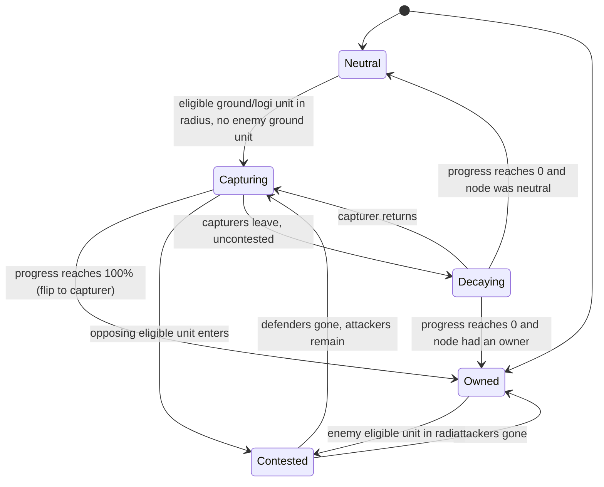

| State | Event / guard | Action | Next |
|---|---|---|---|
| Neutral / Owned | An eligible ground or logistics unit of a non-owner side enters `capture.radius_m`, with no opposing eligible unit present | Emit `CaptureStarted{node_id, side}` | Capturing / Contested |
| Capturing | Tick, still uncontested | Progress += rate × diminishing f(unit count) × garrison modifier × `WORLD_DT`, where the unit count weighs each logistics unit (LOGI_TRUCK, ENEMY_CONVOY) as `capture.logi_weight` of a capturer (PROPOSED 0.5, Q-SM-7) (capture runs on world time, Q-ALN-23). **Garrison modifier (Q-GD-32):** the garrison multiplier `capture.garrison_mult` (capture time ×3, PROPOSED) while any unit of the owning side is at the node, or the empty-base multiplier `capture.empty_base_mult` (capture time ×0.5, PROPOSED) while none is (Q-SM-8). A combat-capable defender freezes progress (Contested); defenders that cannot contest, such as parked air units and Disabled units, slow it through the garrison multiplier instead (Q-ALN-33). A Neutral node has no owner and uses neither multiplier. | Capturing |
| Capturing | Progress ≥ 100% | Set owner = capturer. Reset progress. Emit `NodeCaptured{node_id, from, to, participant_commander_ids[]}`. In the same tick, resolve the losing side's units parked at the node: mobile units able to reach a friendly node escape (RTB): a ground unit when a road route to a friendly base exists, an aircraft when its fuel reaches one of its landing bases (Q-SM-10); every other mobile or parked unit is Destroyed with a crew-survival roll (§4.1, Q-GD-32); facilities switch side and keep their damage (Q-GP-25). Applies to both sides. | Owned |
| Capturing | Opposing eligible, combat-capable unit enters (parked air and Disabled units do not contest, Q-ALN-33) | Freeze progress | Contested |
| Contested | One side's eligible units are all gone | — | Capturing (attacker remains) / Owned (defender remains) |
| Capturing | No capturers, no opponents | — | Decaying |
| Decaying | Tick | Progress −= decay rate × `WORLD_DT` (world time, Q-ALN-23) | Decaying, then Owned/Neutral at 0 |

**Invariants**
- N-1: at most one ownership flip per node per tick.
- N-2: progress stays in [0, 100] and is monotonic while uncontested capture continues.
- N-3: air units never change capture state (GAMEPLAY §8).
- N-4: the SANCTUARY node never leaves Owned (Q-GD-7).
- N-5: all else equal, capture progress per tick at an owned node is lower with a defending unit that cannot contest (parked air, Disabled) present than with none, and zero (Contested) with a combat-capable defender present (Q-GD-32, Q-ALN-33).

### 4.3 Bridge


| State | Event / guard | Action | Next |
|---|---|---|---|
| Intact / Damaged | hp ≤ 0 | Remove the ROAD edge from the graph. Reroute affected convoys. Emit `BridgeDestroyed`. | Destroyed |
| Destroyed / Damaged | Repair actor in radius: a **logistics truck** (slow field repair) or an **engineer** (fast) (Q-GD-11) | Restore hp at the actor's repair rate: engineer = `logistics.bridge_repair_time_s`, truck = that time × `logistics.truck_bridge_repair_mult`. Repair runs on world time (`WORLD_DT`, Q-ALN-23). | Repairing |
| Repairing | hp = max | Restore the edge. Emit `BridgeRepaired{by}`. | Intact |

**Invariants**
- B-1: a Destroyed bridge's edge is absent from every path computed after that tick.
- B-2: a repair never exceeds max hp.

### 4.4 Campaign lifecycle

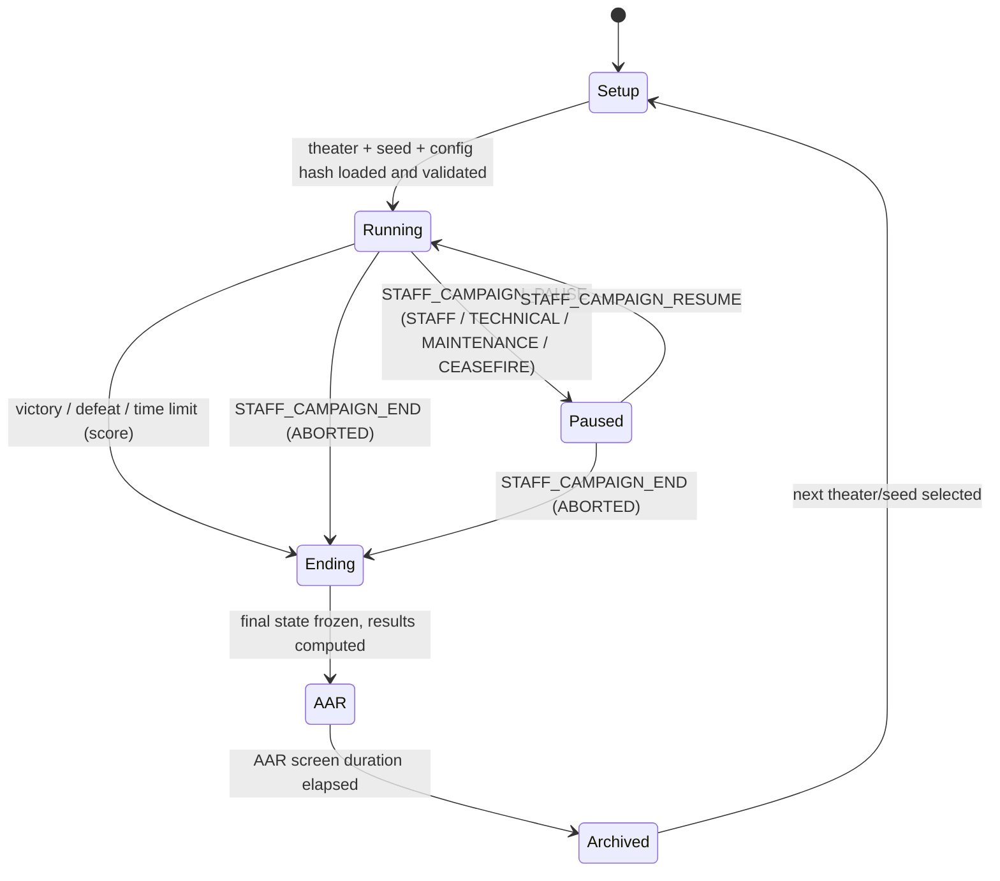

| State | Event / guard | Action | Next |
|---|---|---|---|
| Setup | Theater, seed and balance config pass schema validation | Record `campaign_id`, seed and config hash. Emit `CampaignStarted`. | Running |
| Setup | Validation fails | Refuse to start. Overlay shows "CAMPAIGN SETUP FAILED" (no fallback theater). Alert. | Setup |
| Running | `STAFF_CAMPAIGN_PAUSE{reason_category, sub_reason, note}` from staff (category and note required, Q-RB-1; `sub_reason` optional and allowed only with category `STAFF`, Q-ALN-31; `CEASEFIRE` from the owner, Q-OPS-9), or from SYSTEM for an automatic pause (`TECHNICAL`: broadcast offline longer than `ops.offline_pause_after_min`, Q-OPS-8; `MAINTENANCE`: weekly window, Q-OPS-9) | Set `clock_paused`, `pause_reason` and `pause_sub_reason`. Emit `CampaignClockPaused{reason, sub_reason}` (Q-ALN-3, Q-ALN-31). Alert the owner immediately (ADMIN-RBAC pause flow). Lack of humans never pauses (Q-GD-4 amended). | Paused |
| Paused | Tick | **The whole world freezes** (Q-ALN-2): neither game time nor world time advances, so no movement, combat, logistics, capture, objective timer or other sim timer progresses (SIM-CORE SC-11). | Paused |
| Paused | Chat command that doesn't change the world: `ME` (alias `!status`), or `JOIN` from a commander with no live unit | `ME` works as when Running. The `JOIN` always joins the reserve queue, even when a slot is free (§4.1, Q-ALN-26), and spawns FIFO after resume; a commander still in its respawn delay gets `CommandRejected{reason: RESPAWN_COOLDOWN}` instead, as the delay is frozen while Paused (NX-122). (`!quiet`, `!callsign` and the info commands are handled outside the sim and work as usual.) | Paused |
| Paused | Any other chat command that reaches the sim | Emit `CommandRejected{reason: CAMPAIGN_PAUSED}`; the digest replies "war paused" (Q-ALN-2) | Paused |
| Paused | Safety action: `STAFF_BAN`, `FORGET` or `STAFF_KILL_SWITCH` (Q-ALN-24) | Apply as when Running. A unit orphaned by `STAFF_BAN` or `FORGET` despawns at once (`UnitDespawned{reason: OWNER_BANNED \| OWNER_FORGOTTEN}`) instead of waiting for resume. A banned commander leaves the reserve queue. | Paused |
| Paused | `STAFF_CONFIG_RELOAD` (Q-ALN-24) | Validate and hold; no balance value changes while Paused. Apply held reloads in arrival order in the tick `STAFF_CAMPAIGN_RESUME` is applied, and emit `BalanceReloaded` then. Held reloads are discarded if the campaign ends instead (C-3). | Paused |
| Paused | `STAFF_DIRECTOR_OVERRIDE` (Q-ALN-24) | Emit `CommandRejected{reason: CAMPAIGN_PAUSED}` | Paused |
| Paused | `STAFF_UNBAN`, `STAFF_PURGE_UNITS` or `SYS_SET_CALLSIGN` (Q-ALN-36) | Apply as when Running. Units removed by `STAFF_PURGE_UNITS` despawn at once (`UnitDespawned{reason: PURGED}`). | Paused |
| Paused | `ADVISOR_CHOICE`, or a GM command other than a release (`STAFF_GM_TAKEOVER`, `STAFF_GM_OPERATION`, `STAFF_GM_VERDICT`, `STAFF_GM_LIMITS`, `STAFF_GM_INJECT_JOB`) (Q-ALN-36) | Emit `CommandRejected{reason: CAMPAIGN_PAUSED}` | Paused |
| Paused | `STAFF_GM_RELEASE`, from the GM or from SYSTEM on auto-release (Q-ALN-36) | Apply as when Running: control returns to the director | Paused |
| Paused | `STAFF_CAMPAIGN_PAUSE` | Emit `CommandRejected{reason: ALREADY_PAUSED}` | Paused |
| Paused | `STAFF_CAMPAIGN_RESUME` from staff (GM, admin or owner only, Q-RB-1), or from SYSTEM after the "COMMS RESTORED" countdown ends an offline pause (Q-OPS-8) | Clear `clock_paused`. Emit `CampaignClockResumed{reason}`. Free slots fill from the reserve queue (FIFO). | Running |
| Running | Victory condition held (GAMEPLAY §9), or defeat (the sanctuary's defense HP held at 0 for `campaign.defeat.hold_min`, Q-TH-7) | Freeze inputs. Emit `CampaignEnded{result: VICTORY \| DEFEAT}`. | Ending |
| Running | The campaign clock reaches its time limit (game time), and the two sides' time-limit scores differ | Score per side = `campaign.score.node_share_weight` (PROPOSED 100) × its average share of nodes held over the campaign + `campaign.score.objective_points` (PROPOSED 5) per completed objective (Q-GD-29, Q-SM-9). Freeze inputs. Emit `CampaignEnded{result: TIME_LIMIT, score, winner}`; the higher score wins the war. | Ending |
| Running | Time limit reached and the two scores are exactly equal (Q-GD-29, Q-GP-10) | Freeze inputs. Emit `CampaignEnded{result: TIME_LIMIT, score, winner: null}`: a draw, with the normal end screen. | Ending |
| Running / Paused | `STAFF_CAMPAIGN_END{reason}` | Freeze inputs. Emit `CampaignEnded{result: ABORTED}`. | Ending |
| Ending | Results computed (top contributors per role, stats) | Write results to persistence. Emit `AARStarted{result, top_by_role}`. | AAR |
| AAR | `campaign.aar_duration_s` elapsed | Close the command log. Write the final snapshot. Mark archived. | Archived |
| Archived | Next theater/seed chosen (rotation rule: Q-SM-4) | — | Setup |

**Invariants**
- C-1: in Paused, neither game time nor world time advances: no entity position, hp, stock, capture progress, objective timer or other sim timer changes (Q-ALN-1, Q-ALN-2).
- C-2: exactly one `CampaignEnded` per campaign.
- C-3: no command is applied after Ending.
- C-4: an archived campaign's command log replays to its final state hash.
- C-5: a `TIME_LIMIT` result is emitted only when the campaign clock has reached its limit (Q-GD-29, Q-GP-10).

### 4.5 Theater objective

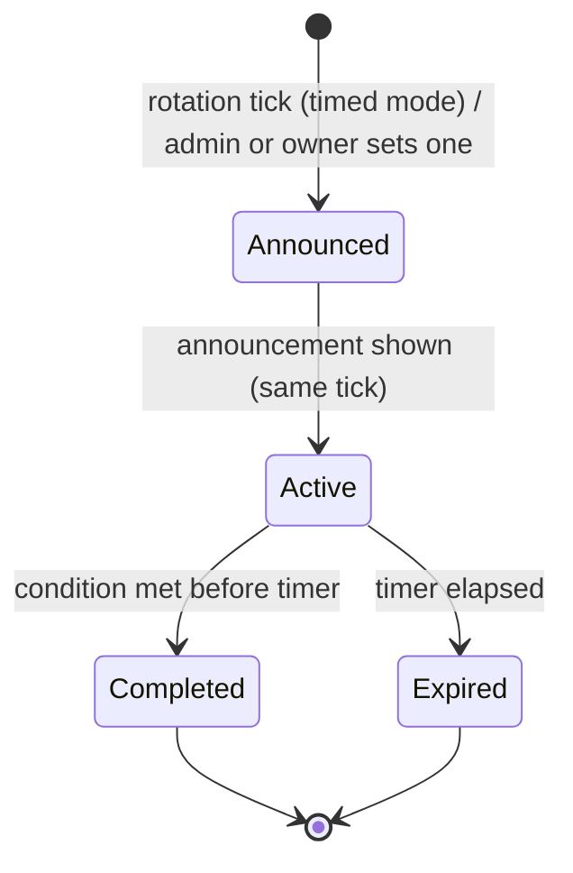

| State | Event / guard | Action | Next |
|---|---|---|---|
| — | Mode `timed`: objective period boundary (`campaign.objective_period_min`, game time, Q-ALN-1), and campaign Running. Mode `off`: never. Any mode: an admin or the owner sets an objective (campaign setup is Admin/owner only; a GM cannot, Q-ALN-10). | Pick uniformly among frontline nodes (a node with a road edge to a node owned by the other side or by no one), never the SANCTUARY or the Static's HQ, using the dedicated `objective` RNG stream (SIM-CORE SC-5, Q-SM-1). An enemy-held node must be captured, an own node held for the whole period (Q-SM-11). Emit `ObjectiveAnnounced`. | Active |
| Active | Condition met (e.g., node captured or held) | Grant merit to participants. Emit `ObjectiveResolved{outcome: COMPLETED}`. Queue a sitrep. | Completed |
| Active | Timer elapsed | Emit `ObjectiveResolved{outcome: EXPIRED}` | Expired |

**Invariants**
- O-1: while the campaign is Running, at most one Active objective exists. In `timed` mode there is exactly one; in `off` mode zero unless an admin or the owner set one (Q-GD-19, Q-ALN-10).
- O-2: none while Paused. The timer is frozen (C-1).

### 4.6 Director tier

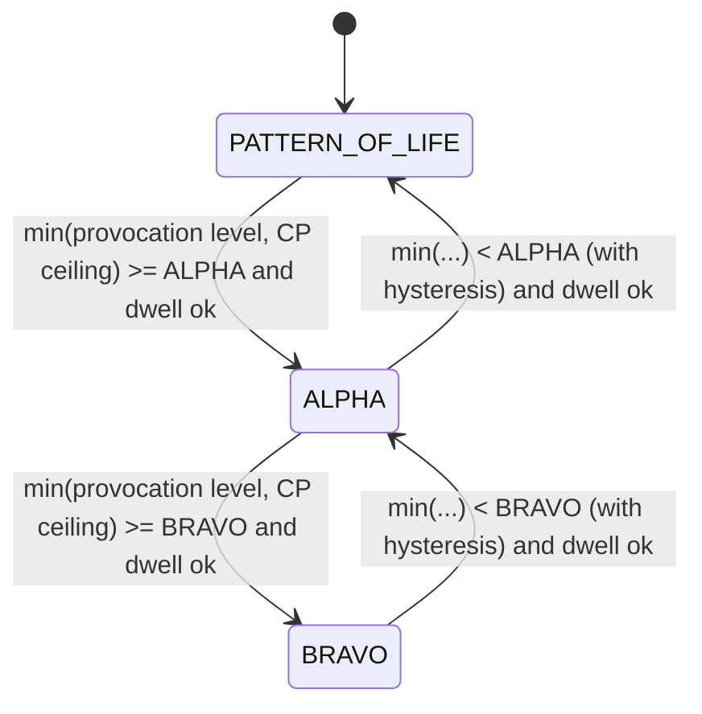

| State | Event / guard | Action | Next |
|---|---|---|---|
| any | Decision window (every `director.window_s`, game time, Q-ALN-23), with CP computed from the **enemy view only** (FOW-4) | Evaluate the escalation rule (THREAT-DIRECTOR §3, Q-TD-1): tier = min(provocation level, CP ceiling from `director.tier.bravo_enter_cp`), with hysteresis (`director.tier.exit_ratio`) and `director.tier.min_dwell_s` (game time, Q-ALN-23) | same / adjacent tier |
| any | Tier changes | Emit `ThreatTierChanged{from, to}`. Queue a sitrep. Update the HUD. | new tier |
| any | `STAFF_DIRECTOR_OVERRIDE{force_tier}` command (OPS-ADMIN §3) while the campaign is Running; rejected with `CAMPAIGN_PAUSED` while Paused (Q-ALN-24) | Force the tier and record the override | forced tier |

**Invariants**
- D-1: tiers only move between adjacent levels, one step per decision window (never PATTERN_OF_LIFE↔BRAVO in one step), except a staff override.
- D-2: no transition happens before the minimum dwell has elapsed (except a staff override).
- D-3: under CP or provocation oscillating within the hysteresis band, no flapping (property test).
- D-4: spend per window ≤ the tier budget.

### 4.7 Commander lifecycle (runtime + persistence)

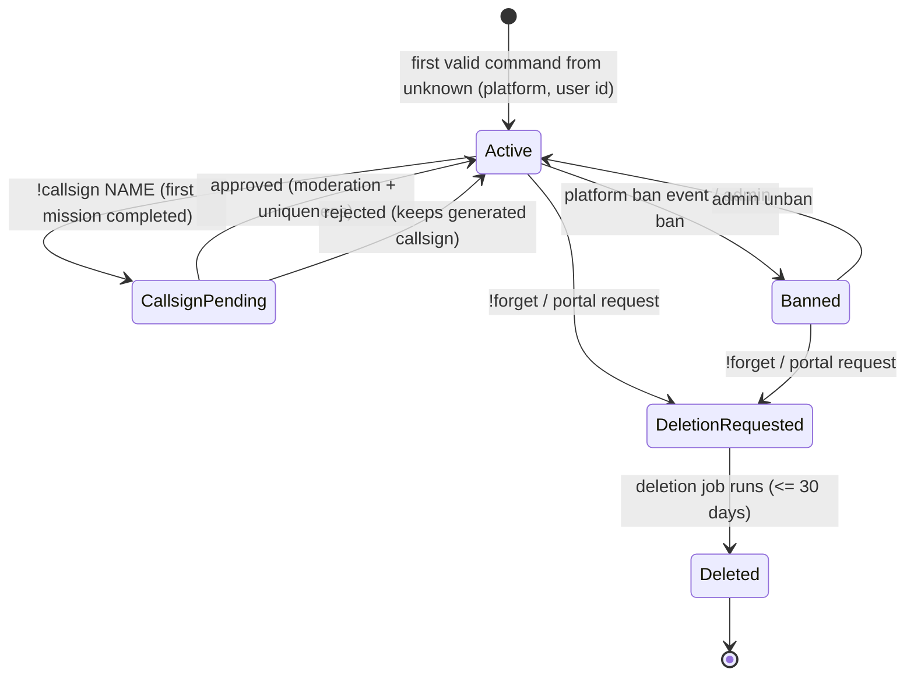

| State | Event / guard | Action | Next |
|---|---|---|---|
| — | First valid command from an unknown `(platform, platform_user_id)` | Create the commander with a generated callsign [FB-1]. Write the audit row `created`. | Active |
| Active | `!callsign NAME`, first mission completed (Q-PROG-3), and the regex passes | Normalize, moderate, check uniqueness, then queue for approval if policy requires it (Q-MOD-1/Q-MOD-2) | CallsignPending |
| CallsignPending | Approved | Set `callsign`, `callsign_kind = CUSTOM`. Audit. Issue `SYS_SET_CALLSIGN` → sim emits `CallsignChanged`. | Active |
| CallsignPending | Rejected | Keep the generated callsign. Audit with the reason. | Active |
| Active | Platform moderation ban event (e.g. Twitch `channel.ban`) or admin ban | Set `banned = true`. Issue `STAFF_BAN` (source SYSTEM for platform sync, STAFF for admin) → the sim emits `CommanderBanned`, orphans the unit and removes the commander from the reserve queue. | Banned |
| Banned | Admin unban | Set `banned = false`. Audit. | Active |
| Active / Banned | `!forget` or portal request | Set `deletion_requested_at` and create the `deletion_requests` row. Issue `FORGET` → the sim emits `CommanderForgotten` and orphans the unit. Stop accepting commands from the identity. | DeletionRequested |
| DeletionRequested | Deletion job | Delete identities. Set the callsign to the tombstone value with `callsign_kind = TOMBSTONE` and set `deleted_at` (DATA-MODEL §4.2, §6.4). Viewers see `REDACTED-` plus a random 4-character tag assigned and stored at deletion time, e.g. `REDACTED-7KQ2` (Q-DM-2, Q-ALN-29). The tag is not derived from any identifier, so it can't be reversed, and distinct deleted commanders stay distinct in replays. Shred the id→name mapping (SEC-DATA-2/3). | Deleted |

**Invariants**
- ID-1: `(platform, platform_user_id)` maps to at most one commander.
- ID-2: a Banned or DeletionRequested commander's commands are rejected before reaching the sim.
- ID-3: the raw display name is never used as a callsign.
- ID-4: a merge never sums XP (SEC-ID-6).

### 4.8 Platform adapter connection

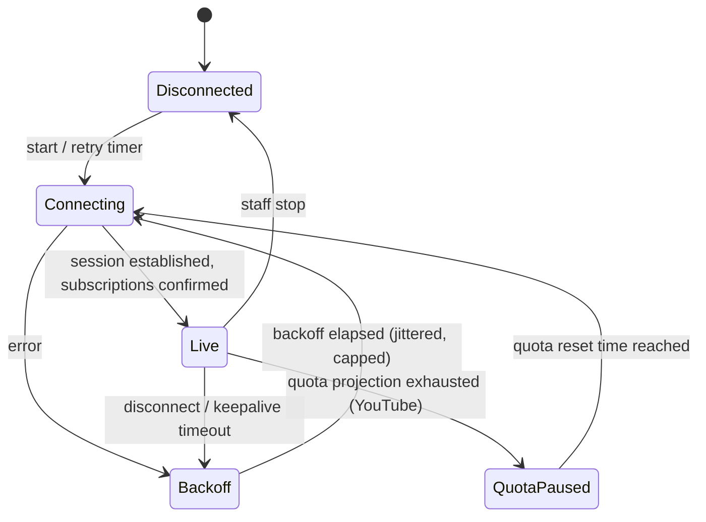

| State | Event / guard | Action | Next |
|---|---|---|---|
| Connecting | Session established (Twitch: EventSub subscription confirmed) | Set health `connected`. Clear the overlay "UPLINK LOST" chip. | Live |
| Live | Disconnect or keepalive timeout | Record the reason. Start backoff. | Backoff |
| Backoff | Down longer than the overlay threshold (CHAT-GATEWAY §7) | Overlay shows "UPLINK LOST". Alert after the alert threshold. | Backoff |
| Live | YouTube quota projection says the quota is exhausted | Stop streaming. Overlay shows "YouTube commands paused until HH:MM" (computed from the platform's reset time). Alert. | QuotaPaused |

**Invariants**
- PA-1: duplicate deliveries are deduplicated by message id in every state.
- PA-2: no command is emitted from an adapter outside Live.
- PA-3: backoff is capped and jittered (no retry storm).

### 4.9 Overlay client

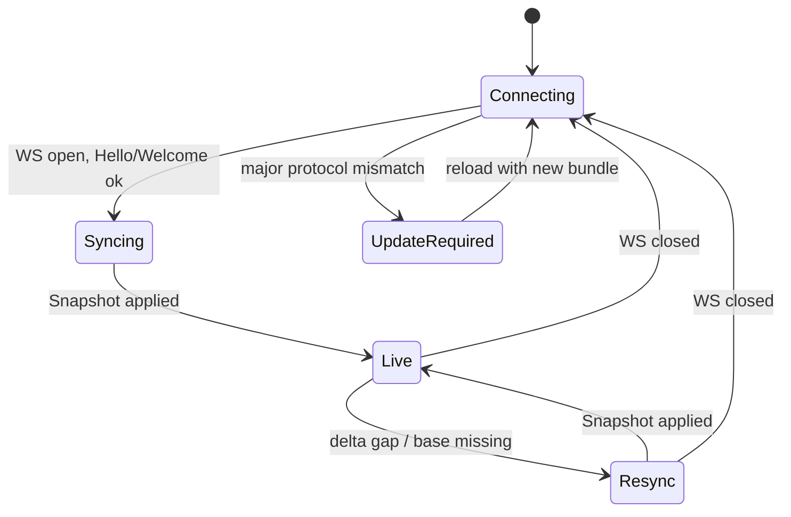

| State | Event / guard | Action | Next |
|---|---|---|---|
| Connecting | WS open, `Welcome` with a compatible major version | Send `Hello`. Request a snapshot. | Syncing |
| Connecting | Major version mismatch (WP-1) | Show "UPDATE REQUIRED". Trigger a reload. | UpdateRequired |
| Live | `Delta.base_tick` ≠ last applied tick | Request resync. Keep rendering the last good frame. | Resync |
| Live / Resync | No data for longer than the banner threshold (WP-5) | Show the "COMMS RESYNC" banner [FB-4] | (unchanged) |
| any | WS closed | Jittered exponential backoff (WP-5) | Connecting |

**Invariants**
- OC-1: the client never renders entities from a delta whose base it hasn't applied.
- OC-2: text is always rendered as text (WP-6, SEC-OV-1).

### 4.10 Ops / stream state

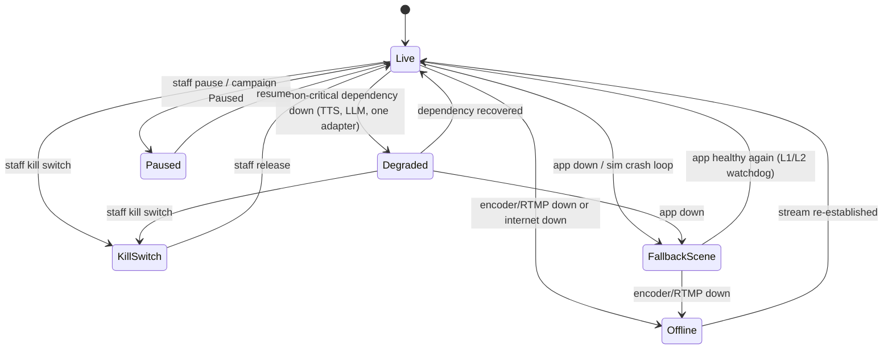

| State | Event / guard | Action | Next |
|---|---|---|---|
| Live | TTS circuit open, LLM breaker open, or one adapter out of Live | Show a degraded chip on the overlay. Text sitreps continue. | Degraded |
| Live / Degraded | Staff kill switch (SEC-MOD-3) | Blank user text, mute TTS, freeze spawns (as logged admin commands) | KillSwitch |
| any | Sim crash loop (SIM-CORE §6: repeated crashes in the window) | OBS switches to the fallback scene "TECHNICAL DIFFICULTIES – CAMPAIGN PAUSED". Alert. | FallbackScene |
| any | Stream-live probe reports offline, or L3 heartbeat missed | Alert from the layer that can reach your phone (MONITORING-WATCHDOG) | Offline |

**Invariants**
- OPS-1: in KillSwitch, no user-derived text reaches the overlay or TTS.
- OPS-2: every transition is logged with its cause, and an admin action carries an audit row.

---

## 5. End-to-end sequence flows

### 5.1 New viewer `!join strike`
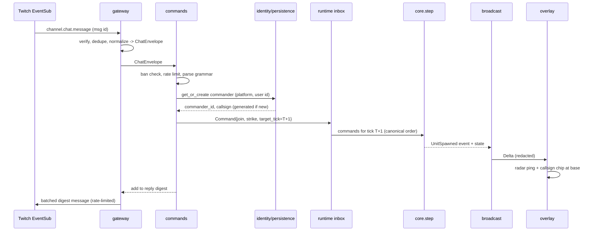
Failure branches:
- Rate-limited → dropped, and a metric is recorded.
- Cap reached → `ReserveQueueJoined`, shown in the overlay queue counter.
- Respawn delay → `CommandRejected{reason: RESPAWN_COOLDOWN}`, included in the periodic digest.

### 5.2 Kill → XP → leaderboard
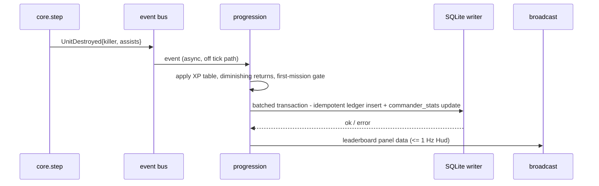
The ledger is the source of truth and `commander_stats` is derived from it in the same transaction (ADR-0003 amendment, DATA-MODEL §5). If the DB write fails, XP stays queued in a bounded buffer and the failure is alerted. The leaderboard shows only persisted values, never values that weren't saved (DI-6).

### 5.3 Capture → objective complete → sitrep
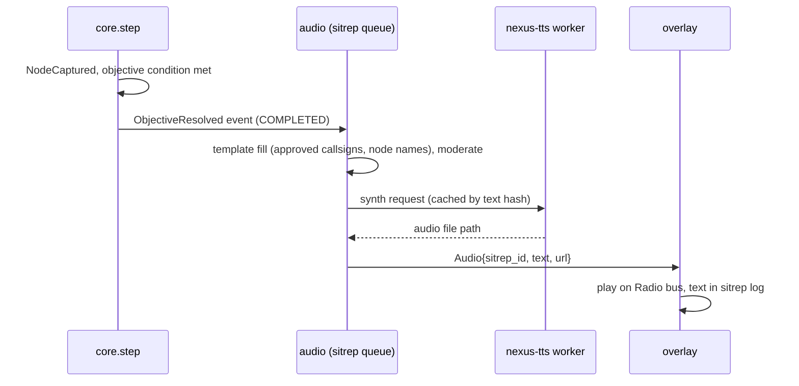
If TTS is down, the circuit breaker opens and the text sitrep still shows (Degraded, 4.10).

### 5.4 Director adaptation: convoy raids → escorts
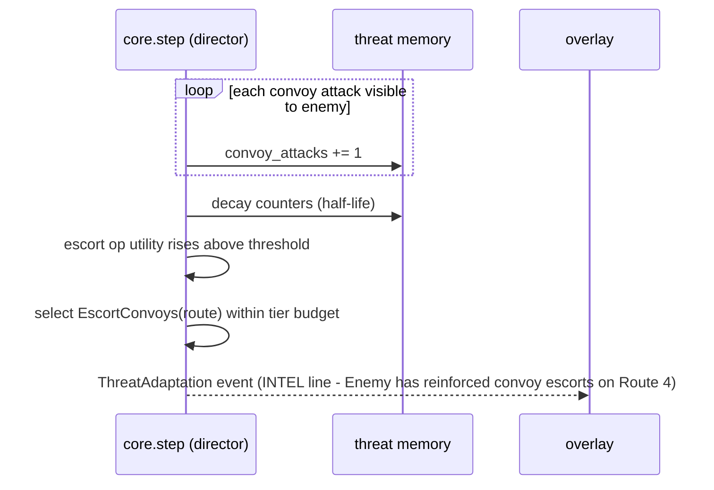
Only attacks the enemy could observe (enemy view, FOW-4) increment the counter.

### 5.5 Campaign end → AAR → next campaign
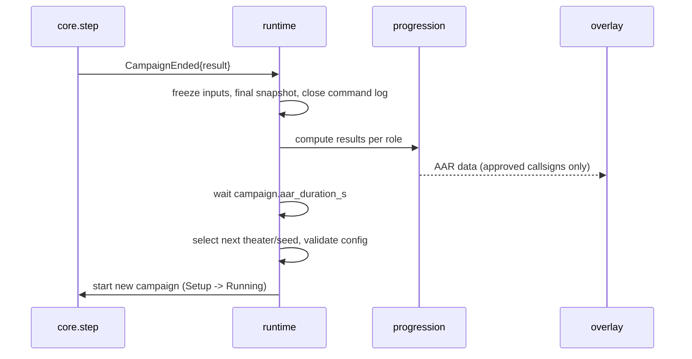

### 5.6 Crash → recovery
```mermaid
sequenceDiagram
    participant RT as runtime
    participant S as supervisor (compose restart policy; host supervisor per ADR-0012)
    participant FS as snapshots + command log
    participant O as overlay
    RT->>RT: exception in step at tick T
    RT->>FS: write crash bundle (seed, config, snapshot ref, log tail)
    RT-->>S: process exits non-zero
    O->>O: WS lost -> COMMS RESYNC banner
    S->>RT: restart
    RT->>FS: load last snapshot (tick S <= T)
    RT->>FS: replay command log S..T
    RT->>RT: verify state hash checkpoints
    RT-->>O: Welcome + Snapshot
```
After repeated crashes inside the window (SIM-CORE §6), the runtime pauses the campaign and Ops switches to FallbackScene.

### 5.7 Deploy without dropping the stream
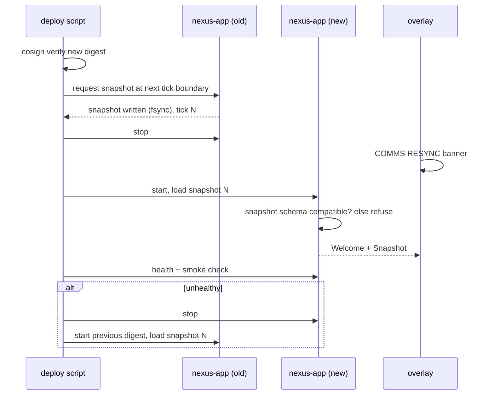

### 5.8 Moderation incident → kill switch → ban cascade
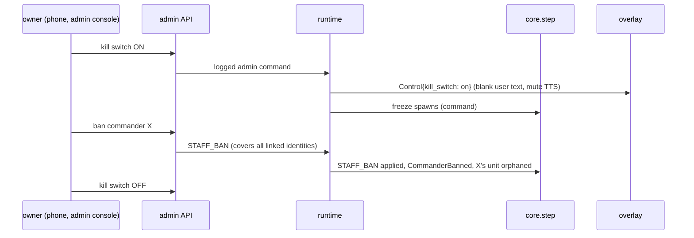
A Twitch `channel.ban` event drives the same ban path without the owner (CHAT-GATEWAY §2).

### 5.9 Internet outage (3-layer watchdog)
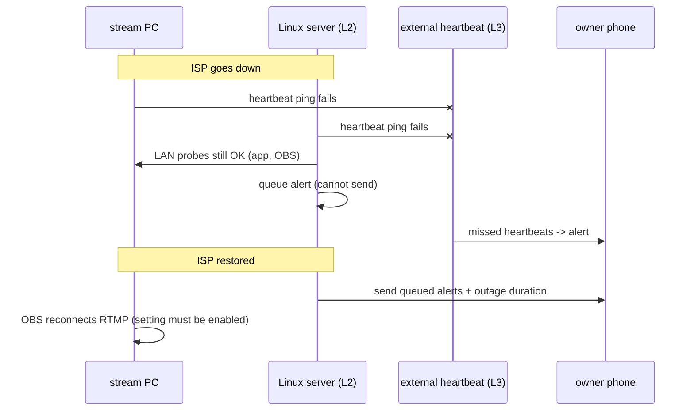

### 5.10 LLM advisor late → rule fallback [FB-2]
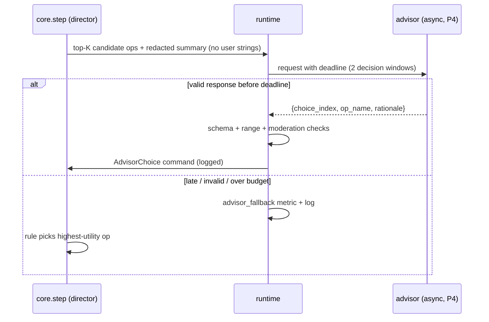

---

## 6. Failure modes (cross-cutting)
| Failure | Machine affected | Required behavior |
|---|---|---|
| Command for a terminal unit | Unit | `CommandRejected{reason: NO_ACTIVE_UNIT}`. No exception (SC-7). |
| Ban arrives mid-capture | Unit, Node | The unit is orphaned. Its capture contribution stops the same tick. |
| Theater config invalid at rotation | Campaign | Stay in Setup, alert, and don't substitute a theater (DI-2). |
| Adapter flapping | Adapter | Backoff is capped. The alert fires once per incident, not once per flap. |
| Snapshot schema change without migration | Deploy | Refuse the deploy (5.7). Never load partially. |

## 7. Test plan
| Invariant(s) | Test type | Location (planned) |
|---|---|---|
| U-1…U-9 | Property (hypothesis): random command sequences, including pauses and node flips | `services/sim/tests/property/test_unit_lifecycle.py` |
| N-1…N-5 | Property + scenario | `.../test_capture.py` |
| B-1, B-2 | Property: pathfinding after destruction | `.../test_bridges.py` |
| C-1…C-5 | Scenario + golden replay (including a time-limit end with a clear winner and an exact tie) | `.../test_campaign.py`, `tests/golden/` |
| O-1, O-2 | Property | `.../test_objectives.py` |
| D-1…D-4 | Property: oscillating CP and provocation | `.../test_director_tiers.py` |
| ID-1…ID-4 | Unit + integration (SQLite) | `services/sim/tests/identity/` |
| PA-1…PA-3 | Adapter fixture tests | `services/sim/tests/gateway/` |
| OC-1, OC-2 | Vitest + Playwright | `apps/overlay/tests/` |
| OPS-1, OPS-2 | Integration (kill switch) | `tests/integration/test_kill_switch.py` |
| Flows 5.6, 5.7 | Integration: kill/restore, deploy rehearsal | `tests/integration/`, staging |

Paths are planned names; they're created with their tracker items.

## 8. Decisions folded in, and open questions
These decisions (2026-10-17 and 2026-10-18) are folded into the tables above:
- **Q-GD-4 (amended):** no automatic clock pause for lack of humans; the Static drops to Pattern of Life (THREAT-DIRECTOR §5a). Only a pause with a reason category stops the clock (§4.4, Q-ALN-3).
- **Q-GD-7, Q-TH-7:** defeat = the sanctuary's defense HP held at 0 for `campaign.defeat.hold_min`; the sanctuary is uncapturable (§4.2 N-4, §4.4).
- **Q-GD-8:** sea domain in **P3** (§4.1 notes).
- **Q-GD-11:** trucks do slow field repair; engineers repair fast and build (§4.3).
- **Q-GD-19 / Q-GD-26 / Q-CBT-1/6/7 / Q-GD-27:** objective modes (§4.5), Tasking Board and auto-tasking (Q-GP-23), damage states, stance, munitions and repair (§4.1).
- **Q-MOD-1 / Q-MOD-2 / Q-SM-3:** generated callsigns; custom callsigns after the first completed mission (Q-PROG-3), automated moderation with a review queue, and manual owner approval during alpha (§4.7).
- **Q-SM-1:** objective selection uses its own `objective` RNG stream (SIM-CORE SC-5).
- **Q-SM-4:** rotate theater archetypes with no back-to-back repeats; reuse the first theater with a new seed until more exist; admins can override via scheduling.
- **Q-SM-5:** superseded; `campaign.pause_after_no_humans_s` does not exist.
- **Spec-alignment batch (2026-10-18):** Q-ALN-1 (game time vs world time, §4.1, §4.4, §4.5), Q-ALN-2 (pause freezes the world; allowed commands, §4.4, U-8), Q-ALN-3 (pause reason categories, §4.4), Q-ALN-5 (respawn delay in game time, §4.1), Q-ALN-8 and Q-GD-35 (idle handoff and retire are the only idle rule, §4.1), Q-ALN-9 (AUTO unit keeps its slot; reclaim, §4.1, U-7), Q-ALN-10 (objectives set by admin or owner only, §4.5), Q-OPS-8 and Q-OPS-9 (automatic pauses, §4.4), Q-PROG-6 (no minimum-humans XP rule, §5.2), Q-DM-2 (`REDACTED-…`, §4.7).
- **Spec-alignment batch (2026-10-18, continued):** Q-ALN-23 (capture, decay and bridge repair on world time; director window and dwell on game time, §4.2, §4.3, §4.6), Q-ALN-24 (staff and system commands while Paused, §4.4, U-8), Q-ALN-25 (idle retire of a Disabled unit; idle handoff for `hold` units, §4.1), Q-ALN-26 (`JOIN` while Paused always queues; idle-timer resets; AUTO tag, §4.1, §4.4), Q-ALN-29 (`REDACTED-` tag, §4.7), Q-ALN-31 (pause sub-reason, §4.4).
- **Q-GD-29:** time-limit score, no Stalemate result (§4.4, C-5, Q-GP-10).
- **Q-GD-32:** units parked at a captured base escape or are destroyed (§4.1, §4.2, U-9); garrison and empty-base capture multipliers (§4.2, N-5).
- **Spec-alignment batch 3 (2026-10-18):** Q-ALN-33 (combat-capable defenders freeze capture; defenders that cannot contest slow it, §4.2, N-5), Q-ALN-36 (unban, purge and set callsign apply while Paused; advisor choices and GM commands other than a release are rejected, §4.4, U-8).

- **Grill 2026-10-21 (Q-SM-6 … Q-SM-12):** §4.1–4.6 approved; logistics units count as half a capturer; garrison and empty-base capture multipliers; the time-limit score weights; how units escape a captured base; how timed objectives are picked; objective voting and a self-directed mode parked in GAMEPLAY-LATER.

Still open here: nothing for §4.1–4.6. §4.7–4.10 and §5 are grilled when P2 starts on them.
