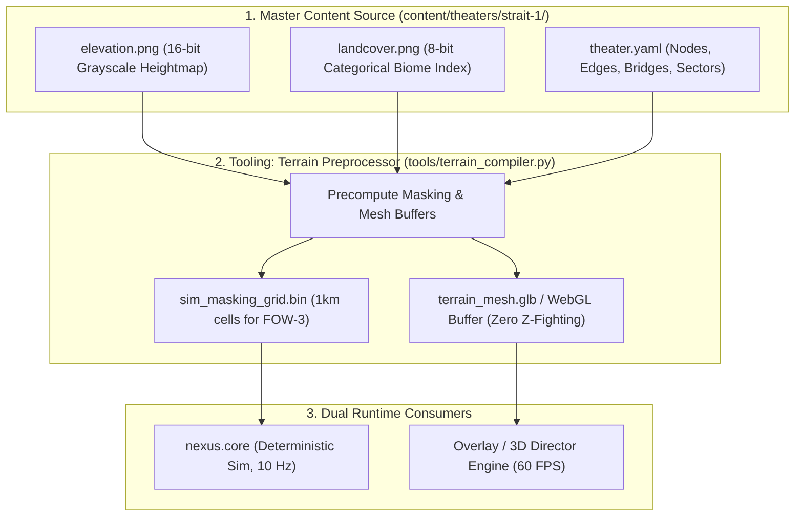

# Unified Terrain, Biomes & Z-Fighting Architectural Specification

> **Operation Nexus / Hiveplex — Theater & Environment Engineering**
> *Status: Proposed Spec Upgrade for `contracts/config/theater.json` and `CONFIG-AND-CONTENT.md` §9*
> *Storage: External Brain Artifact (Decoupled from Git Repository)*

---

## 1. Current State vs. Gaps in Existing Specs

### 1.1 What the Current Specs Contain (`CONFIG-AND-CONTENT.md` §9.1)
Currently, a theater is defined primarily as a **graph network with an optional heightmap**:
```yaml
bounds_m: { w: 400000, h: 240000 }
terrain:
  heightmap: "theaters/strait-1/heightmap.png" # 16-bit PNG (Optional in first build)
  height_scale_m: 2500
  sea_level_m: 0
  masking_regions: [...]                      # Polygons for LoS sensor blockage
nodes: [...]                                  # Airbases, FOBs, Bridges
edges: [...]                                  # ROAD / SEA_LANE connections
```

### 1.2 The Missing Architectural Elements
1. **No Landcover / Biome Standard:** The spec has no vocabulary for differentiating between **ocean, lake, river, beach, grassland, forest, desert, and urban zones**.
2. **No Vertical Elevation Budget (Z-Fighting Root Cause):** There is no defined rule for where roads, water surfaces, bridges, and shorelines sit in 3D space, leading to coplanar polygon collision.
3. **No Simulation Gameplay Feedback:** Forests do not yet provide sensor clutter or convoy speed penalties; cities do not reflect radar clutter; rivers do not impede ground units unless a bridge exists.

---

## 2. Eliminating Z-Fighting: The 3 Core Graphics Rules

Z-fighting occurs when two polygons occupy the exact same depth coordinates ($Y=0$) or when floating-point precision collapses across vast tactical distances ($0.5\text{ m} \dots 400\text{ km}$).

```
[ Elevated Bridge Span ]  ──────►  Y = +14.0m
[ Road / Infrastructure]  ──────►  Y = +3.0m   (polygonOffset: -1, -2)
[ Ground / Lowland Plain] ──────►  Y = +2.0m   (polygonOffset: 1, 1)
[ Beach / Shoreline Bevel] ─────►  Y = 0.0m
[ Water Surface (River/Strait)] ►  Y = -2.5m
[ Channel Bed / Lake/Sea Trench]►  Y = -8.0m
```

### 2.1 The Three Enforced Mitigations:
1. **Physical Elevation Budget (Layer Budget):** Never allow two distinct surface types to share the same $Y$ coordinate. Water is strictly recessed ($Y = -2.5\text{m} \dots -4\text{m}$), beaches sit at $Y = 0\text{m}$, terrain plains at $Y = +2\text{m}$, and bridges rise cleanly at $Y = +12\text{m} \dots +18\text{m}$.
2. **Topological Carving (Non-Overlapping Meshes):** The land mesh must **never** render geometry beneath water surfaces. Water channels are physically cut out from the terrain mesh (either via Boolean CSG or two distinct landmass meshes), guaranteeing that no two triangles overlap in $(X, Z)$.
3. **Engine-Level Precision:**
   - Enable `logarithmicDepthBuffer: true` in `THREE.WebGLRenderer` to distribute 24-bit/32-bit depth precision evenly across logarithmic distance.
   - Apply `polygonOffset: true` (`factor: -1`, `units: -2`) on wireframes, runways, and road decals to keep them cleanly above the terrain surface.

---

## 3. Proposed Biome & Landcover Taxonomy

We propose adding a standard `landcover` classification to `contracts/config/theater.json`:

| Biome Code | Name | Physical Elevation | Gameplay Sim Effect (SIM-CORE) | Visual Shading Style |
|---|---|---|---|---|
| `0x00` | `OCEAN_DEEP` | $-20\text{ m} \dots -100\text{ m}$ | Impassable for ground; naval domain (P3) | Deep navy abyss with bathymetric wireframe |
| `0x01` | `WATER_INLAND` (River/Strait/Lake) | $-2.5\text{ m} \dots -5.0\text{ m}$ | Blocks ground convoys unless bridge exists | Translucent teal/cyan flow with shore bevels |
| `0x02` | `BEACH_SHORE` | $-0.5\text{ m} \dots +1.0\text{ m}$ | Amphibious transit zone; convoy speed $0.6\times$ | Pale cyan/amber contour transition line |
| `0x03` | `PLAINS_LOWLAND` | $+2.0\text{ m} \dots +80\text{ m}$ | Baseline terrain; convoy speed $1.0\times$ | Standard dark slate with subtle grid |
| `0x04` | `FOREST_WOODLAND` | $+50\text{ m} \dots +200\text{ m}$ | Radar clutter; NOE air masked; convoy speed $0.7\times$ | Emerald/cyan cluster glyphs or procedural trees |
| `0x05` | `DESERT_ARID` | $+10\text{ m} \dots +150\text{ m}$ | High dust signature (thermal bloom); speed $0.85\times$ | Warm amber contour lines with sparse dune ridges |
| `0x06` | `HIGHLANDS_ROCK` | $+450\text{ m} \dots +2500\text{ m}$ | Full radar LoS masking (`masking_regions`); impassable for trucks | Steep wireframe peaks with topographic density |
| `0x07` | `URBAN_METRO` | $+10\text{ m} \dots +60\text{ m}$ | High radar clutter; repair rate $+25\%$; cover | Dense rectilinear block grid with neon node anchors |

---

## 4. Multi-Layer Theater Authoring Pipeline



### 4.1 Theater File Schema Upgrade (`contracts/config/theater.json`)

```yaml
schema_version: 2
slug: strait-1
name: "Strait One — Contested Lifeline"
bounds_m: { w: 400000, h: 240000 }

terrain:
  elevation_map: "theaters/strait-1/elevation.png"
  height_scale_m: 2500
  sea_level_m: 0
  landcover_map: "theaters/strait-1/landcover.png"
  
  elevation_budget_m:
    water_surface: -2.5
    beach: 0.0
    plains: 2.0
    roads: 3.0
    bridges: 14.0

biomes:
  - id: FOREST_NORTH
    kind: FOREST_WOODLAND
    speed_mult: 0.70
    radar_clutter: true
    polygon: [[-120000, 40000], [-80000, 60000], ...]

bridges:
  - id: bridge_north
    node_id: north_bridge
    spans_nodes: [fob_nw, north_crossing]
    clearance_m: 14.0
    deck_width_m: 18.0
    structural_hp: 500
```

---

## 5. Road and Supply Route Visualization

Logistics convoys (`TRUCK`, `SUPPLY_CONVOY`, `ENEMY_CONVOY`) traverse theater edges (`layer: ROAD` in `content/theaters/strait-1.yaml`). Roads are rendered across all display paradigms to communicate supply flow and chokepoints:

### 5.1 Road Classification & Styling

| Road Class | Simulation Layer | Width (m) | Elevation ($Y$) | Visual Styling (3D) | Visual Styling (2D Vector) |
| :--- | :--- | :--- | :--- | :--- | :--- |
| `MSR_PRIMARY` | `ROAD` | $14\text{ m}$ | $+0.20\text{ m}$ | Dark tarmac ribbon (`0x071526`), animated pulsing luminous centerline dashes | Double-stroked glowing corridor with directional chevrons |
| `CONNECTOR_SPUR` | `ROAD` | $8\text{ m}$ | $+0.15\text{ m}$ | Compacted granular surface, subtle perimeter boundary | Dashed tactical vector trace |
| `BRIDGE_CAUSEWAY` | `ROAD` (`bridge`) | $18\text{ m}$ | $+2.00\text{ m}$ | Elevated engineered causeway spanning recessed water channel, support pylons | Cross-hatched chokepoint box with structural integrity gauge |

### 5.2 Z-Fighting Elimination for Roads
Road meshes must sit slightly proud of the ground terrain mesh to eliminate coplanar polygon collision:
- **Ground terrain**: $Y = 0.00\text{ m}$
- **Road ribbons**: $Y = +0.20\text{ m}$ with `polygonOffset: true`, `factor: -1`, `units: -2`
- **Elevated bridges**: $Y = +2.00\text{ m}$ spanning over the $-3.50\text{ m}$ water channel bed
- **Convoy ground clearance**: $Y = +0.35\text{ m}$ (units stay snapped to road elevation)

---

## 6. Three-Pillar Visual Strategy & Future Engineering Roadmap

Hiveplex adopts a **Three-Pillar Visual Architecture**, standardizing three visual styles that consume `RenderFrameState`:

1. **Pillar 1: Modern Tactical GIS / C2 Operations Map** (Flat 2D Euclidean `L.CRS.Simple`):
   - Optimized for strategic campaign monitoring, web companion site, post-war replay, and **MGRS grid-based unit command tasking**.
2. **Pillar 2: Textured Low-Poly Military RTS** (3D PBR WebGL):
   - Optimized for primary 24/7 live stream viewing, dynamic air/ground combat, and viral vertical video clipping (Shorts/TikTok).
3. **Pillar 3: Holographic Tactical Wireframe** (2.5D / 3D Vector Holotable):
   - Optimized for high-contrast sensor overview, DEFCON/cyberpunk aesthetic, and low-bandwidth/low-noise stream segments.

### 6.1 Future Technical Focus Areas

1. **Dynamic Road Conforming to Terrain Elevation (Spline Draping)**:
   - Sample the 16-bit DEM heightfield at $10\text{m}$ intervals along road splines ($y = \text{SampleDEM}(x, z) + 0.22\text{m}$).
   - Construct continuous 3D triangle ribbons following terrain curvature, with terrain flattening cutaways along MSR corridors.
2. **Multi-Texture Splatting & Biome Blending**:
   - PBR shader blending coastal sand, arid plains, craggy granite (triplanar mapped on vertical cliffs), and asphalt.
3. **MGRS Tactical Grid & Player Command Integration**:
   - Hierarchical $50\text{km}$ macro / $10\text{km}$ tactical / $1\text{km}$ target grid coordinates mapping bidirectionally to simulation coordinates for chat/web commands (`!strike <grid>`, `!route`).
4. **Color & Faction Palette Harmonization**:
   - Unifying Coalition (Quorum cyan/navy) and Static (Null scarlet/carbon black) across 2D, 3D, and MFD displays.
